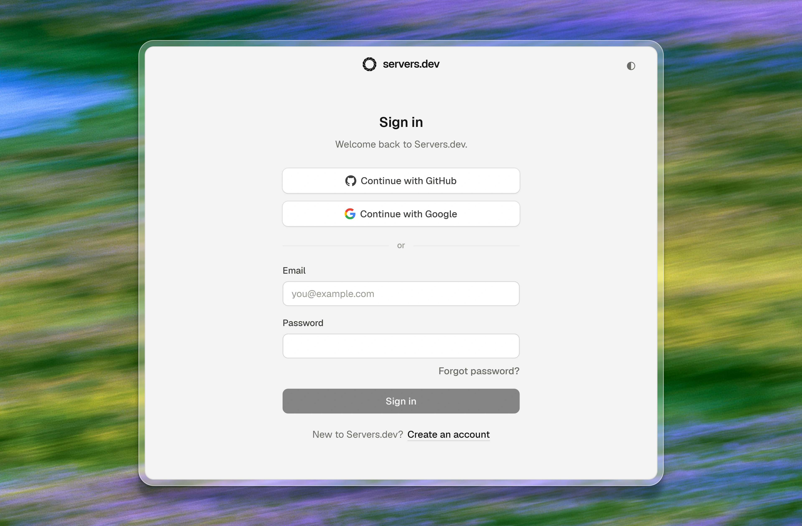

## Create an account

Open your server's panel. The sign-in page shows only the sign-in methods your server offers.

- **Email and password**: click **Create an account**, then enter your name (optional), your email and a password of at least 10 characters. Click **Create account**. The platform sends you a verification email.
- **GitHub or Google**: click **Continue with GitHub** or **Continue with Google**. The platform uses the verified email of that account, so your email counts as verified right away. If the account has no verified email, the sign-in fails; verify one at GitHub or Google and try again.

Every account comes with a personal organization. See [Organizations](/account/organizations).

## Verify your email

Until your email is verified, a banner on every page reminds you. You can't create tokens, approve CLI sign-ins, create orgs or projects, invite people, deploy, connect GitHub or add a card.

1. Open the link in the verification email. It is valid for 48 hours.
2. If you aren't signed in, the panel asks you to. Sign in to the account that asked for the link; the panel verifies it right after.

To get a new link, click **Resend email** in the banner. The platform sends at most three emails an hour to one address.

<Note>
  A verification link only works for the account it was sent to. If you are signed in as someone else, the panel says so and offers **Sign in with another account**.
</Note>

## Sign in

- **Email and password**: enter both and click **Sign in**.
- **GitHub or Google**: click **Continue with GitHub** or **Continue with Google**. If an account already uses the same verified email, the sign-in method is added to it and you get an email about it. One account can have several sign-in methods.

You stay signed in for 30 days after you last used the panel. After that, the sign-in page says **Your session expired. Sign in again.**

### Sign in again

Changes that add a new way into your account need a sign-in within the last 10 minutes: connecting GitHub or Google, setting a first password, [creating a token](/account/tokens#create-a-token) and [approving a CLI sign-in](/account/tokens#sign-in-the-cli-from-the-browser).

If your sign-in is older, the panel shows **For your security, sign in again to continue.** Click **Sign in again**, or **Sign in with GitHub** or **Sign in with Google**. After you sign in, the panel brings you back to where you were.

## Reset your password

<Steps>
  <Step title="Ask for a link">
    On the sign-in page, click **Forgot password?**. Enter your email and click **Send reset link**.
  </Step>
  <Step title="Open the email">
    The link is valid for one hour. The panel shows the same message whether or not the address has an account.
  </Step>
  <Step title="Choose a new password">
    Enter it twice and click **Set password**. You are signed in with it right away.
  </Step>
</Steps>

<Warning>
  Resetting your password signs you out everywhere and revokes all your personal access tokens, including the one `atoll login` saved. Run `atoll login` again afterwards, and replace the tokens your CI uses.
</Warning>

A reset link also verifies your email.

## The Account page

Click your name at the bottom of the sidebar, then **Account**. The page has four tabs: **Profile**, **Access tokens**, **Notifications** and **Appearance**.

### Profile

- **Name**: click **Edit**, change it and click **Save**. People in your organizations see it. Leave it blank to remove it; they then see your email instead.
- **Email**: your address, marked **Verified** or **Unverified**.

### Sign-in methods

The **Sign-in methods** section lists the methods your server offers, **Email and password**, **GitHub** and **Google**, and shows which are connected.

- To add GitHub or Google, click **Connect** on its row. You sign in at the provider and come back to the Account page.
- To remove one, open the menu at the end of its row and click **Disconnect**. You can't remove your last sign-in method.

A GitHub or Google account can belong to only one account, and your account can have only one of each. You get an email whenever a sign-in method is added or removed.

### Password

- If you signed up with GitHub or Google, click **Set a password** on the **Email and password** row to add one.
- To change your password, open the menu on the **Email and password** row and click **Change password**. Enter your current password and the new one twice.

Passwords need at least 10 characters. You can only change them in the panel, not with a token.

When you set or change your password, every other session of yours is signed out and you get an email. Your personal access tokens keep working. To end them too, click **Revoke all tokens** in the message that appears.

### Session

**Sign out** on the **Profile** tab ends your session in this browser. **Sign out** in the account menu at the bottom of the sidebar does the same.

To sign out of every other browser, change your password.

### Notifications

The emails the platform sends you about deploys, spend limits and runners. The bell at the bottom of the sidebar opens this tab too. See [Email notifications](/teams/notifications).

### Appearance

Pick **System**, **Light** or **Dark**. **System** follows your device's setting. The choice is saved in this browser only.

On the sign-in page and the pages that emails link to, a button at the top right switches between light and dark.

## Servers without accounts

A self-hosted server can run without user accounts. Then the panel asks for the server's API token, the `ATOLL_TOKEN` it was started with, instead of a sign-in. There are no organizations or tokens, and the Account page only has the theme. **Forget token** in the account menu removes the token from this browser.

## Troubleshooting

<AccordionGroup>
  <Accordion title="Too many sign-in attempts">
    After 10 failed sign-ins for one email within 15 minutes, the platform stops accepting attempts for that email for a while. The message says how many minutes to wait. Reset your password if you don't remember it.
  </Accordion>
  <Accordion title="Couldn't verify your email">
    The link has expired or was already used. Sign in and click **Resend email** in the banner to get a new one.
  </Accordion>
  <Accordion title="This GitHub or Google account is already linked">
    Each GitHub or Google account can sign in to one account only. Sign in to the other account and disconnect it there first. If your account already has a different GitHub or Google account, disconnect that one first.
  </Accordion>
  <Accordion title="Someone else signed up with my email">
    An address only belongs to an account once it is verified. If someone signed up with your address and never verified it, reset the password or sign in with GitHub or Google using that address. The account becomes yours, and the platform removes what the other person set up: their sessions, tokens, sign-in methods, the members and invites of the personal org, its GitHub connections and its payment details.
  </Accordion>
</AccordionGroup>
