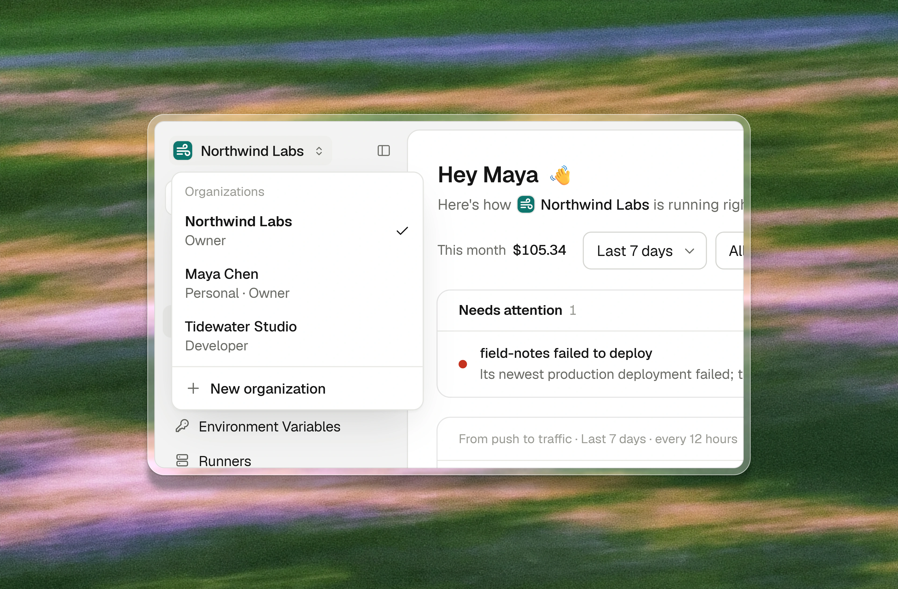

An organization, or org, holds projects, data stores, members, billing and GitHub connections. This page covers the orgs themselves. For roles and invites, see [Teams and roles](/teams/teams). For plans and spend, see [Billing](/teams/billing).

## Personal and team orgs

- **Personal**: every account comes with one. It is named after you, or after the part of your email before the `@`, and its slug is made from that name, for example `ada-lovelace`. You are always its owner. You can rename it and invite people to it, but you can't leave it or delete it.
- **Team**: every other org, the ones you create and the ones you are invited to.

The org's page shows which kind it is, its slug and your role.

## Switch orgs

The panel shows one org at a time. The projects in the sidebar, **Overview**, **Projects**, **Storage**, **Environment Variables**, **Runners** and the **Organization** pages all belong to the current org.

To switch, click the org name at the top of the sidebar and pick another one. The menu lists every org you belong to with your role, your personal org first.



- The panel remembers the choice in this browser. Opening a link to a page of another org also switches to it.
- On an org page, the panel opens the same page of the new org. On a project page, it goes back to **Projects**.
- If you leave the org you had picked, the panel falls back to your personal org.

The CLI keeps its own default org for each server:

```sh
atoll orgs ls             # your orgs, your role in each, the personal and the default one
atoll orgs switch acme    # new projects from atoll deploy now go to acme
```

You can also pass `--org <slug>` to `atoll login` or `atoll deploy`. Without a default, new projects go to your personal org. See [Deploying with the CLI](/deploy/cli).

## Create an org

<Steps>
  <Step title="Open the dialog">
    Click the org name at the top of the sidebar, then **New organization**. You can also click **New organization** on the **General** tab of an org's settings.
  </Step>
  <Step title="Name it">
    Enter a name of up to 100 characters. The panel suggests a slug from it: `Acme Inc.` becomes `acme-inc`. Edit the slug if you want another one.
  </Step>
  <Step title="Create it">
    Click **Create organization**. You are its owner, and the panel opens its projects.
  </Step>
</Steps>

<Warning>
  The slug is used in URLs and by the CLI, and can't be changed later.
</Warning>

A slug has 3 to 40 lowercase letters, digits or `-`. It starts with a letter, doesn't end with `-`, has no `--`, and must not be taken on the server.

You need a verified email to create an org. Orgs are created in the panel; the CLI can only list them and pick the default.

## The org's settings

Click **Settings** in the sidebar's **Organization** group. The header shows the org's name, its slug, whether it is personal or a team, and your role.

- **General**: the name, slug, type and your role, a button for a new org, and the **Danger zone** to delete a team org.
- **Members**: who is in the org and what each can do. See [Teams and roles](/teams/teams).
- **Git**: the GitHub accounts connected to the org. Admins install the GitHub App here. See [Deploying from GitHub](/deploy/git).

**Billing** has its own entry in the sidebar. See [Billing](/teams/billing).

## Rename an org

Only owners can rename an org.

1. Open **Settings** and stay on the **General** tab.
2. Click **Rename** next to the name.
3. Enter the new name and click **Save**.

The slug stays the same, so URLs, scripts and `atoll orgs switch` keep working.

## Leave an org

1. Open the org's **Members** tab.
2. Open the menu on your own row, marked **you**, and click **Leave** with the org's name, for example **Leave Acme**.
3. Confirm with **Leave**.

You lose access to the org's projects right away, until someone invites you again. You can't leave your personal org. The last owner can't leave either: make someone else an owner first.

## Delete an org

Only owners can delete an org, and only a team org.

<Steps>
  <Step title="Empty it">
    Delete the org's projects and data stores. The platform refuses to delete an org while any are left, and names the projects that are in the way. Deleting a project needs the Admin role.
  </Step>
  <Step title="Delete it">
    Open **Settings**. On the **General** tab, under **Danger zone**, click **Delete organization**.
  </Step>
  <Step title="Confirm">
    Type the org's slug and click **Delete organization**.
  </Step>
</Steps>

Deleting removes the org and everyone's membership in it. It can't be undone. The members keep their accounts and their other orgs.
