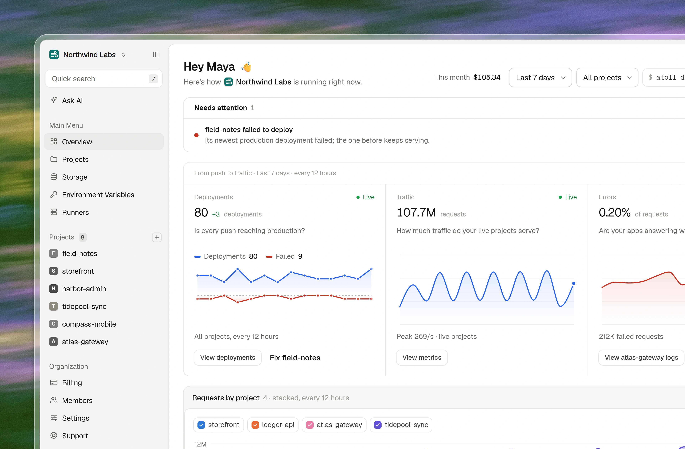
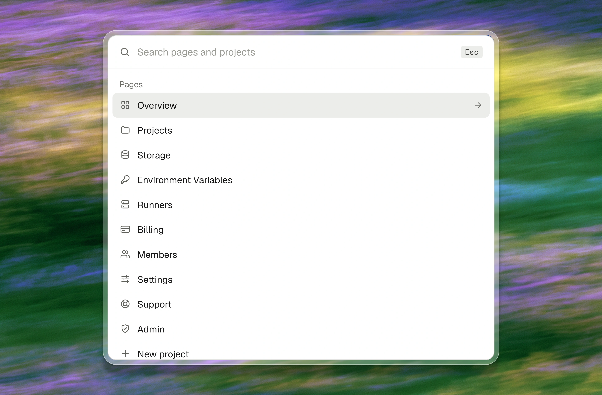

## The sidebar

The sidebar on the left shows the current organization and its pages. From top to bottom:

- **The org switcher**: the current org. Click it to switch to another org or create one. See [Switch orgs](/account/organizations#switch-orgs).
- **Quick search**: opens [quick search](#quick-search).
- **Main Menu**:
  - **Overview**: the org at a glance. Deployments, traffic and errors over a period, its busiest projects and its recent deployments. A note on top warns about failed deployments, stopped apps or a spend limit that is 80% used. See [Overview dashboards](/observe/overview).
  - **Projects**: all of the org's projects.
  - **Storage**: the org's Postgres databases, Redis caches and Files buckets. See [Storage](/storage/overview).
  - **Environment Variables**: the variables of the org's projects, and the variables they share. See [Environment variables](/configure/environment-variables).
  - **Runners**: the machines that build the org's apps. See [Runners](/run/runners).
- **Projects**: the org's six most recently deployed projects, with the total count next to the heading. With the Developer role or higher, the **+** next to the heading creates a project.
- **Organization**: the org's **Billing**, **Members** and **Settings**. See [Organizations](/account/organizations).
- **Platform**: only for the admins of the server, with the **Admin** pages.

At the bottom are the server's version, or **Server unreachable** when the panel can't reach it, your name and the bell. Click your name for **Account** and **Sign out**. The bell opens your [email notification](/teams/notifications) settings.

Pages inside a project or a data store show where you are above the title, for example **Projects / my-app**. Click **Projects** to go back.

### Collapse the sidebar

Click **Collapse sidebar**, the button next to the org name, to fold the sidebar to a column of icons. Click **Expand sidebar** to open it again. The panel remembers this in your browser.

### Narrow windows

In windows narrower than 900 pixels the sidebar is hidden. A bar at the top has buttons for the menu, quick search and notifications. The menu opens as a drawer over the page; press `Esc` or click beside it to close it.

## Quick search

Press `/` or `Ctrl+K` (`Cmd+K` on a Mac), or click **Quick search** in the sidebar. Start typing to filter the results:

- **Pages**: every page in the sidebar, plus **New project** and **Account**.
- **Projects**: the current org's projects. Search by a project's name, its production URL or its GitHub repository.

Use the up and down arrow keys to pick a result and `Enter` to open it. Clicking a result works too.

## Keyboard shortcuts

| Keys | What it does |
|------|--------------|
| `/` | Open quick search, except while you type in a field |
| `Ctrl+K` or `Cmd+K` | Open quick search, also from a field |
| Up and down arrows | Move through the quick search results |
| `Enter` | Open the picked result |
| `Esc` | Close quick search, a dialog or the menu drawer |

## Links to panel pages

Panel addresses contain a `#`, for example `https://atoll.example.com/#/projects/my-app` or `https://atoll.example.com/#/account/tokens`. You can bookmark and share them. If you open one while signed out, the panel asks you to sign in and then opens the page.
