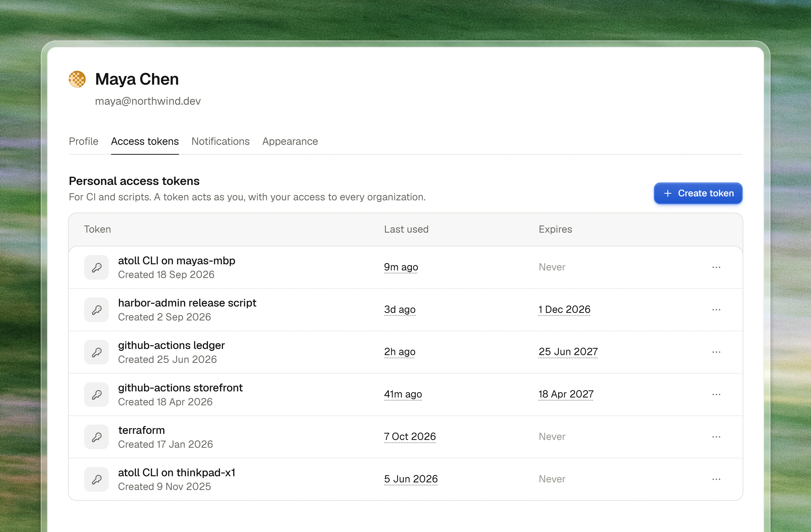

## Personal access tokens

A personal access token lets the CLI or a script act as you, with your role in every organization you belong to. Use one where `atoll login` can't open a browser, such as CI.

### Create a token

<Steps>
  <Step title="Open the tokens tab">
    Go to **Account** and open the **Access tokens** tab.
  </Step>
  <Step title="Name the token">
    Click **Create token**. Enter a name that says where it's used, such as `github-actions`, and pick when it expires: **30 days**, **90 days** (the default), **1 year** or **No expiry**.
  </Step>
  <Step title="Copy the secret">
    Click **Create token**. The panel shows the secret once. Copy it into your CI's secrets right away; you can't see it again.
  </Step>
</Steps>

Secrets start with `atoll_pat_`.

To create a token you need a verified email and a sign-in within the last 10 minutes. If your sign-in is older, the dialog asks you to [sign in again](/account/account#sign-in-again).

Tokens can only be created in the panel. A token can't create other tokens, change your password or approve a CLI sign-in. The platform emails you every time a token is created, so you notice one you didn't make.

### Use a token

Pass it to the CLI with `--token` or the `ATOLL_TOKEN` environment variable:

```sh
ATOLL_TOKEN=atoll_pat_... atoll deploy
```

Or save it on a machine, the way `atoll login` does:

```sh
atoll login --token atoll_pat_...
```

`ATOLL_TOKEN` wins over a saved login. For a full CI setup, see [Deploying from CI](/deploy/ci).

### The token list

The **Access tokens** tab lists your tokens, newest first, with when each was created, last used and expires. Tokens that `atoll login` created are listed too, named `atoll CLI on <host>` after the computer they were made for.



### Revoke a token

Open the menu at the end of the token's row and click **Revoke**, then **Revoke token**. Scripts and CI jobs that use it stop working at once.

Resetting your password revokes all your tokens. Changing it doesn't, but the panel offers to. See [Password](/account/account#password).

## Sign in the CLI from the browser

`atoll login` signs the CLI in through the panel, so you never type a password into the terminal.

<Steps>
  <Step title="Run atoll login">
    ```sh
    atoll login --server https://atoll.example.com
    ```

    The CLI prints a URL and an 8-letter code such as `BDFG-HJKL`, and opens the URL in your browser. If the browser doesn't open, copy the URL into it.
  </Step>
  <Step title="Check the code">
    The panel shows **Sign in the CLI.**, the code and the account the CLI will act as. If you aren't signed in, sign in first.
  </Step>
  <Step title="Approve">
    If you ran `atoll login` and the code matches your terminal, click **Approve**. The page says **CLI signed in.** and the CLI saves a token.
  </Step>
</Steps>

- The code is valid for 10 minutes. If it runs out, run `atoll login` again.
- Approving needs a verified email and a sign-in within the last 10 minutes.
- If you didn't start the sign-in, click **Deny**. The CLI stops and isn't signed in.

The token the CLI gets does not expire. It shows up in the **Access tokens** tab as `atoll CLI on <host>`. To end it, run `atoll logout` on that computer, or revoke it in the panel.

`atoll whoami` shows who the CLI is signed in as and where its token comes from. See the [CLI reference](/reference/cli) for every option of `atoll login`.
