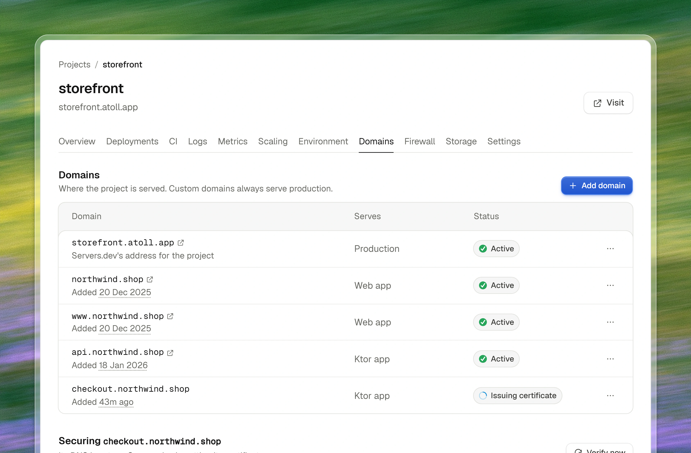

This page is the short version. The [domains reference](/reference/domains) has every rule: apex domains, proxies like Cloudflare, moving a domain between projects, and the server settings.

## Add a domain



In the panel, use the project's **Domains** tab. From the CLI, in the project directory:

```sh
# The primary Ktor server
atoll domains add api.example.com

# The primary web app
atoll domains add www.example.com --web

# A specific module
atoll domains add admin.example.com --module :admin
```

Without `--module`, the domain follows the project's [primary module](/primary-module) of its kind, also when the primary module changes. Adding and removing domains needs the Admin role.

## Create the DNS records

The platform answers with two DNS records to create at your DNS provider:

```text
Added api.example.com to 'my-app'.
api.example.com PENDING_VERIFICATION (KTOR)
Create these DNS records at your DNS provider:
  TYPE   NAME                              VALUE
  TXT    _atoll-challenge.api.example.com  atoll-verify-5f0c2a9e7b1d4c3a8e6f9b2d1a7c4e80
  CNAME  api.example.com                   cname.atoll.app
If the records are still missing on 2026-10-27 09:14 UTC, the domain is removed.

Atoll checks the records every few minutes. To check now: atoll domains verify api.example.com
```

The TXT record proves the domain is yours; keep it as long as the domain is in use. The CNAME record sends the traffic to the platform. The panel shows the same records.

## Verify

The platform checks the records on its own, every minute at first and less often later. To check right away:

```sh
atoll domains verify api.example.com
```

It exits with `0` once the domain is `ACTIVE`, `2` while it is still pending or getting its certificate, and `1` if it failed. The [domains reference](/reference/domains#verification-and-certificates) explains each status. A domain that is not verified within 7 days is removed.

## List and remove

```sh
atoll domains ls
atoll domains rm api.example.com
```

The commands use the project in the current directory; pass `--project` (or `-p`) to name another one.

## Production only

Custom domains serve production. [Previews](/deploy/previews) keep their own hosts.
