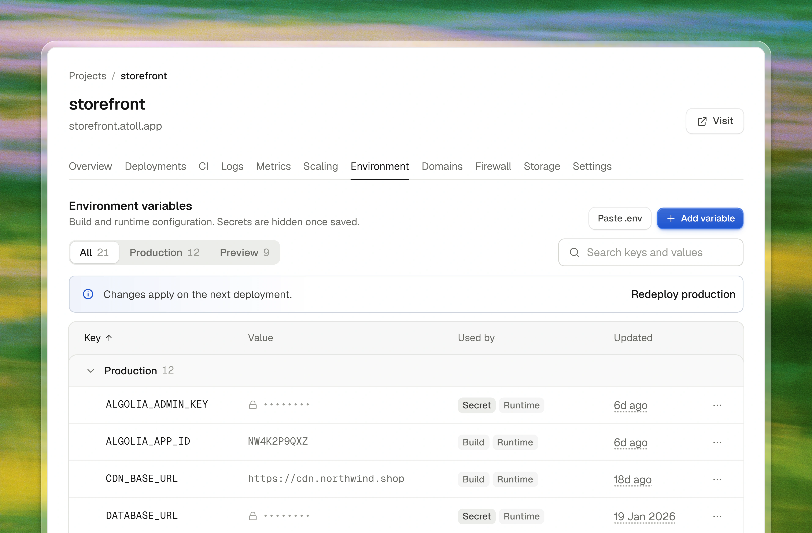

This page explains when to use which setting. The [env vars reference](/reference/env) has the full rules: limits, `.env` file syntax and secret masking.

## Environments

Each variable is set for one environment:

- `production`: production deployments.
- `preview`: [previews](/deploy/previews) of pull requests.

The same key can have a different value in each environment. The CLI changes `production` unless you pass `--env preview` (or `-e preview`).

## Build, runtime or both

A variable is passed to both by default. Turn one off when a value is only needed in one place:

| Used by | Example | Flag to turn the other off |
|---------|---------|----------------------------|
| Only the build | an API URL baked into a web app, `GRADLE_OPTS` | `--no-runtime` |
| Only running servers | a database password | `--no-build` |

## Secrets

Mark API keys, passwords and tokens as secret with `--secret`. A secret's value can't be read back from the panel, the CLI or the API, and it is masked in deployment logs. To change a secret, set a new value.

Values typed on the command line can end up in your shell history. For secrets, use `atoll env import` with a file you delete afterwards, or the panel.

## Set, list and remove



In the panel, use the project's **Environment** tab. From the CLI:

```sh
atoll env set API_URL=https://api.example.com --no-runtime
atoll env set API_URL=https://staging-api.example.com --no-runtime --env preview
atoll env import .env.production --secret --no-build
atoll env ls
atoll env ls --env preview
atoll env rm API_URL --env preview
```

The commands use the project named after the current directory, like `atoll deploy`. Pass `--project` (or `-p`) to choose another one.

Reading plain values needs the Viewer role; secrets are never shown. Setting and removing needs the Developer role.

## When changes apply

Changes apply on the next deployment. To apply them right away, use the **Redeploy production** button in the panel's **Environment** tab. It redeploys the latest production deployment.

## Names and limits

Letters, digits and `_`, not starting with a digit. `PORT` is reserved, because the platform sets it for your Ktor servers. Names starting with `ATOLL_` are reserved for the platform. A project can have up to 500 variables across both environments, and a value can be up to 64 KB.
