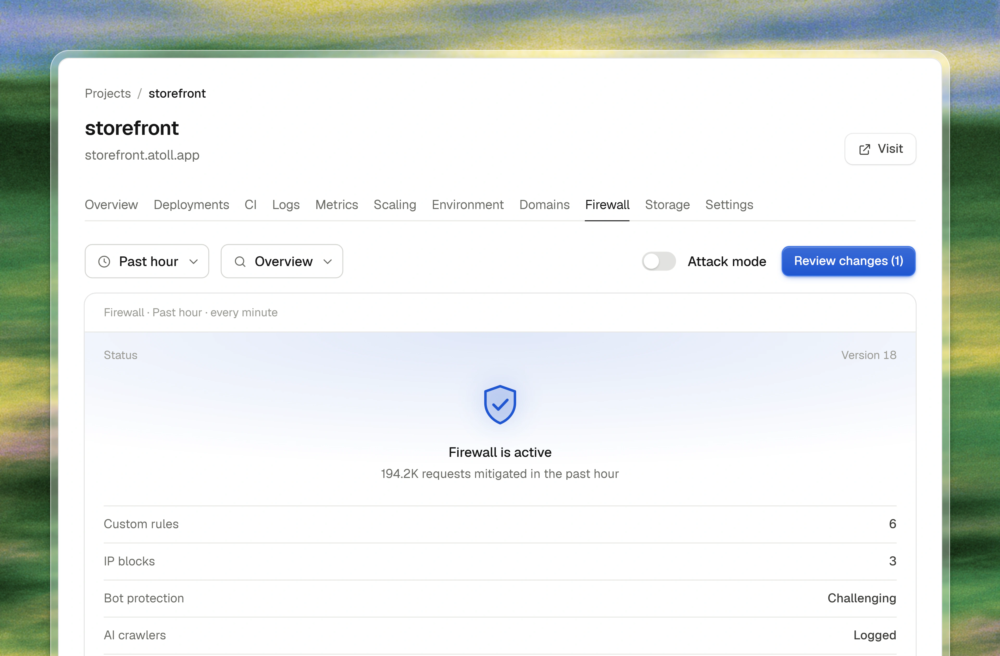

Every project has a firewall in front of its web apps and Ktor servers. It can block IPs, run your own rules (deny, challenge, redirect, rate limit), stop bots and AI crawlers, catch common attacks with the OWASP core rules, and challenge every visitor while you are under attack. Changes take effect within seconds, without a redeploy.

Open it in the panel from the project's **Firewall** tab, or use `atoll firewall` (`atoll fw` for short). Anyone in the project can look at it; changing it needs the Developer role.

Rules apply to every host of the project: production, previews and custom domains. Requests the firewall denies, challenges or rate limits are never billed.

## How a request is checked

The platform checks each request in this order. The first step that ends the request wins:

1. **Temporary blocks**: IPs a rule blocked for a while (see [persistent actions](#persistent-actions)).
2. **IP blocking**: your list of blocked IPs and ranges.
3. **Attack mode**, when it is on.
4. **Custom rules**, top to bottom.
5. **Managed rulesets**: bot protection, AI bots, OWASP core rules.

A request that gets through all of them reaches your app.

## Custom rules

A rule has conditions and an action. Conditions sit in groups: all conditions in a group must match, and the rule matches when any group does.

```sh
atoll fw rules add --name "Block admin" \
  --if "path starts_with /admin" --not "ip in 203.0.113.0/24" \
  --then deny
```

Each condition is `field op value`. `--if` adds one, `--not` (or a leading `!`) adds a negated one, and `--or` starts the next group.

| Field | Operators |
|-------|-----------|
| `path`, `host`, `user_agent`, `header:<name>`, `cookie:<name>`, `query:<name>` | `equals`, `starts_with`, `ends_with`, `contains`, `matches`, `in`, `exists` |
| `method`, `environment` (`production`, `preview`), `protocol` (`http/1.1`, `h2`, `h3`) | `equals`, `in` |
| `ip` (IPs or CIDR ranges, IPv4 and IPv6) | `equals`, `in` |
| `country` (two-letter code, e.g. `DE`), `continent` (`EU`, `NA`, ...), `asn` (e.g. `13335`) | `equals`, `in` |

Text comparisons ignore case. `in`, `starts_with`, `ends_with` and `contains` take several values separated by commas (write `\,` for a comma inside a value). `matches` takes a regular expression in RE2 syntax. `exists` takes no value: `header:x-api-key exists`.

### Actions

| `--then` | What happens |
|----------|--------------|
| `log` | Nothing; the request shows up in the traffic view under the rule |
| `deny` | A 403 page |
| `challenge` | A short check page that a browser solves on its own; then the visitor gets through for an hour |
| `bypass` | Skips the remaining custom rules and the managed rulesets (not IP blocking or attack mode) |
| `redirect:<to>` | A 307 to a path or URL; add `:permanent` for a 308, e.g. `redirect:/maintenance:permanent` |
| `rate-limit` | Counts requests; clients over the limit get the follow-up action |

### Rate limits

```sh
atoll fw rules add --name "Login" \
  --if "path equals /login" --if "method equals POST" \
  --then rate-limit --limit 10 --window 1m --key ip --then-limit too-many-requests
```

`--limit` requests per `--window` (10 s to 1 h) are allowed for each `--key`: `ip`, `user_agent` or `header:<name>`, and you can combine up to three. `--algorithm` is `fixed-window` (the default) or `token-bucket`. Over the limit, `--then-limit` decides: `too-many-requests` (429 with `Retry-After`, the default), `deny`, `challenge` or `log`. Counters are kept per region.

### Persistent actions

`deny`, `challenge` and `rate-limit` can also block the client's IP for a while, from 1 minute to 24 hours:

```sh
atoll fw rules add --name "Scanners" --if "path matches \.(env|git)" --then deny --persist 1h
```

The IPs blocked this way are listed with `atoll fw blocks list`; `atoll fw blocks remove <ip>` lifts a block at once.

## IP blocking

```sh
atoll fw ip block 203.0.113.7 --note "scraper"
atoll fw ip block 198.51.100.0/24 --host shop.example.com
atoll fw ip list
atoll fw ip unblock 203.0.113.7
```

Without `--host` the block applies to every host of the project.

## Managed rulesets

| Ruleset | Settings |
|---------|----------|
| Bot protection | `off`, `log`, `challenge`: clients that don't look like browsers (no or a tool's user agent, missing browser headers). Verified search engine bots pass |
| AI crawlers | `allow`, `log`, `deny`: bots that collect training data, by a built-in list of user agents |
| AI assistants | `allow`, `log`, `deny`: fetches an AI assistant makes for a user, by a built-in list |
| OWASP core rules | On or off; paranoia level 1 to 4, anomaly threshold, and `off`, `log` or `deny` per group (SQL injection, XSS, RCE, and more) |

```sh
atoll fw managed set bot-protection challenge
atoll fw managed set ai-crawlers deny
atoll fw managed set owasp on --paranoia 2 --group php=off
```

The OWASP rules look at the request line, headers, query and cookies. They only inspect request bodies with `--inspect-bodies` (up to `--max-body`, 1 MB by default). Requests with larger bodies are then refused, so raise the limit before you turn this on for an app that takes uploads.

## Attack mode

Attack mode challenges every visitor, except verified search engine bots and visitors who already solved the challenge. It applies at once, without publishing:

```sh
atoll fw attack-mode on --for 1h
atoll fw attack-mode off
```

`--for` turns it off again by itself after up to 24 hours; without it, it stays on until you turn it off.

## Traffic and alerts



The **Firewall** tab shows the requests of the last 10 minutes, hour or day by action (allowed, logged, challenged, denied, rate limited), the rules that matched, and samples of mitigated requests. From the CLI:

```sh
atoll fw traffic --range 24h --by country
atoll fw traffic --by ip --action denied
```

`--by` groups by `ip`, `path`, `host`, `country`, `asn`, `user-agent` or `rule`. Minute-by-minute data is kept for a day, hourly totals for 30 days.

When more than 100,000 requests are mitigated within 10 minutes, the project's admins get an email and the tab shows an alert; at most one an hour.

## Drafts, publishing and versions

Rules, IP blocks and managed rulesets are edited in a draft. Nothing changes for your visitors until you publish:

```sh
atoll fw diff                          # what publishing would change
atoll fw publish -m "Block admin"      # live within seconds
atoll fw discard                       # throw the draft away
```

In the panel it is **Review changes**, then **Publish**. Each publish makes a new version; the last 50 are kept. `atoll fw versions` lists them and `atoll fw restore <n>` publishes an older one again as a new version.

`atoll fw export -o firewall.json` writes the whole config as JSON, and `atoll fw import firewall.json` loads one into the draft, for example to copy a firewall to another project.

## Test with log first

A rule that matches more than you meant can lock out real visitors. Add new rules with `--then log`, publish, and watch them in the traffic view for a while (`atoll fw traffic --by rule`). When only the requests you meant show up, switch the action:

```sh
atoll fw rules edit "Block admin" --then deny
atoll fw publish
```

## Examples

```sh
# Block an IP
atoll fw ip block 203.0.113.7

# Rate limit the login form: 5 tries a minute per IP, then block for 15 minutes
atoll fw rules add --name "Login" --if "path equals /login" --if "method equals POST" \
  --then rate-limit --limit 5 --window 1m --persist 15m

# Block a country
atoll fw rules add --name "No RU" --if "country equals RU" --then deny

# Challenge curl and wget
atoll fw rules add --name "CLI clients" --if "user_agent contains curl,wget" --then challenge

# Let your own API clients past the managed rulesets
atoll fw rules add --name "API" --if "header:x-api-key exists" --then bypass

atoll fw publish
```

`atoll fw rules list` shows the rules with their ids; other `rules` commands take an id, a position or a name. `atoll fw status` shows the published version, unpublished changes, attack mode and your plan's limits.

## Plan limits

| | Free | Pay as you go |
|-|------|---------------|
| Custom rules | 3, at most 1 rate limit | 40 |
| IP blocks | 10 | 100 |
| Rate limit window | 10 s to 10 min | 10 s to 1 h |
| Rate limit keys and algorithm | `ip`, fixed window | All |
| Persistent actions | No | Yes |
| OWASP core rules | No | Yes |
| Bot protection, AI bots, attack mode, traffic, alerts | Yes | Yes |

Saving or publishing past a limit fails with a hint to switch plans; see [Billing](/teams/billing).

## Good to know

- Ktor servers are only filtered on the platform's Kubernetes clusters. A server running in local mode filters web apps only, and the tab says so.
- Countries and networks come from the client IP. IP geolocation by [DB-IP](https://db-ip.com).
