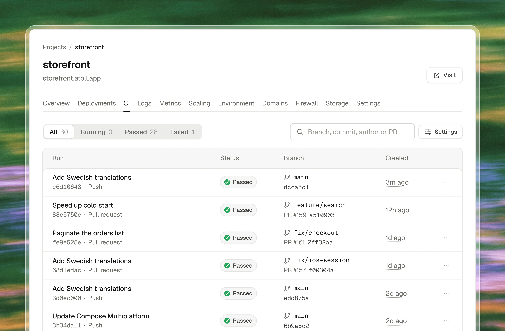

CI runs Gradle tasks of a [git-linked project](/deploy/git) on every push and pull request, and reports the result
back on the commit. It builds on the same Linux infrastructure as deployments, so there is nothing to set up besides
turning it on.

## Turn it on

CI is off by default. Open the project's **Settings** tab and find **CI**, or use the CLI:

```sh
atoll ci enable                                          # run check on every push and pull request
atoll ci enable --tasks check,:server:test --branches main,dev
atoll ci status                                          # show the settings
atoll ci disable
```

| Setting | Meaning | Default |
|---------|---------|---------|
| Tasks | Gradle tasks to run, e.g. `check` or `:server:test` (up to 20, task paths only, no options) | `check` |
| Branches | Pushes to these branches run; pull requests always run | all branches |

Changing the settings needs the **Admin** role. `atoll ci enable` keeps the tasks and branches you don't pass;
`--all-branches` goes back to every branch. The project must be linked to a repository first.

## What runs

Every push to a matching branch, and every pull request that is opened, reopened or gets new commits, starts a run.
A run downloads the commit, keeps the project's root directory and runs `./gradlew <tasks> --continue` there, so one
failing task doesn't hide the others. Runs are Linux only.

A new push to a branch cancels that branch's run if it is still queued or running, so only the newest commit is
tested. Rerun a run to test the same commit again with the current settings and vars.

### Pull requests from forks

Pull requests from forks run too, but never get [secret env vars](/reference/env); plain ones are passed as usual.

## Env vars

A run gets:

| Var | Value |
|-----|-------|
| `CI` | `true` |
| `ATOLL_CI_RUN_ID` | the run's id |
| `ATOLL_GIT_SHA` | the commit being tested |
| `ATOLL_GIT_BRANCH` | its branch |
| the project's [CI vars](/reference/env#ci-vars) | as set |
| [shared vars](/reference/env#shared-env-vars) with the `ci` target | as set; a CI var with the same key wins |

The project's deployment vars are not passed. Secret values are masked in the log.

```sh
atoll env set --ci SONAR_TOKEN=... --secret
atoll env set --shared GRADLE_ENTERPRISE_KEY=... --target ci --all-projects --secret
```

## Results

The project's **CI** tab lists the runs with their status, branch, commit, message and duration. A run's page shows
its live log and the Gradle tasks that failed (from `> Task :x FAILED` lines). A run is `QUEUED`, `RUNNING`,
`PASSED`, `FAILED` (a task failed), `CANCELLED` or `ERROR` (the platform couldn't run it, not a test failure).



```sh
atoll ci ls [--limit 50] [--branch main]
atoll ci logs <run> [--follow]           # with --follow, exits 1 unless the run passed
atoll ci rerun <run>
atoll ci cancel <run>
```

Run ids can be shortened to their first characters, as `atoll ci ls` shows them. Reading runs needs the **Viewer**
role; rerunning and cancelling them needs **Developer**.

Every run reports a commit status named `atoll-ci/<project>`: pending while it is queued or running, then success,
failure (a task failed) or error (cancelled, or the platform couldn't run it). To keep pull requests with failing tests from
being merged, add `atoll-ci/<project>` as a required status check in the repository's branch protection rules on
GitHub.

Runs and their logs are kept for 90 days.

## Billing

CI time counts as build minutes, like deployment builds, and shows up as such on the org's usage and invoices. An org
that can't deploy because its free allowance is used up or its spend limit is reached gets no new runs either: each
push still shows up as an `ERROR` run with the reason, and the commit gets an error status.

## Self-hosting

| Variable | Default | Meaning |
|----------|---------|---------|
| `ATOLL_CI_TIMEOUT_MINUTES` | `30` | a run that takes longer is stopped and ends as `ERROR` |
| `ATOLL_CI_MAX_CONCURRENT` | `2` | runs at once per server; more wait as queued. Separate from the build slots of deployments |

Runs use the builder image as Kubernetes Jobs with `ATOLL_RUNTIME=kubernetes`, and local Gradle otherwise.
Commit statuses need the GitHub App's **Commit statuses** permission, which [git.md](/deploy/git) already asks for.
