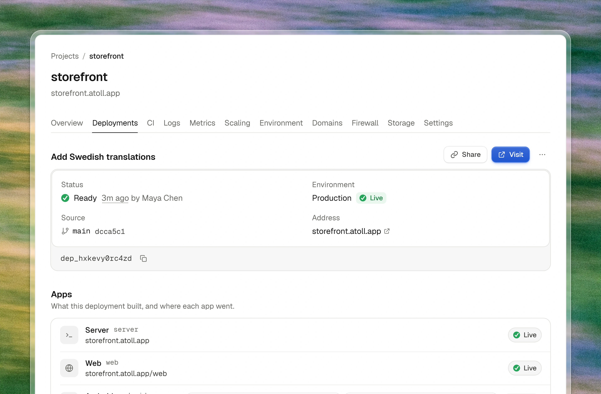
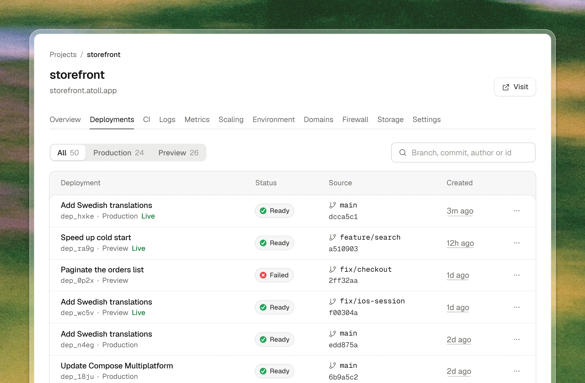

## Deployment statuses

A deployment moves through these statuses:

```text
QUEUED → BUILDING → DEPLOYING → READY | PARTIAL | FAILED
                                  (or CANCELLED at any point)
```

| Status | Meaning |
|--------|---------|
| `QUEUED` | Waiting for a free build slot. |
| `BUILDING` | Gradle is building the targets. |
| `DEPLOYING` | Targets are going live one by one. |
| `READY` | Every target that could be built is live. Some may be `SKIPPED`. |
| `PARTIAL` | At least one target is live and at least one `FAILED`. |
| `FAILED` | Nothing new went live. |
| `CANCELLED` | Someone stopped it before it finished. Targets that were already live stay live. |

`READY`, `PARTIAL`, `FAILED` and `CANCELLED` are final. A finished deployment never changes again.

## Target statuses

Each target of a deployment has its own status:

| Status | Meaning |
|--------|---------|
| `DEPLOYING` | Still building or going live. |
| `READY` | Live. Ktor servers and web apps have a URL; Android and desktop targets have files. |
| `SKIPPED` | The platform did not build or roll out this target, for example [iOS](/targets/ios). The reason is shown. Not a failure. |
| `FAILED` | The target did not go live. The error is shown. |

The deployment's final status follows from its targets:

- Any `FAILED` target makes it `PARTIAL` if something else went live, or `FAILED` if nothing did. The error lists the failed targets, e.g. `1 of 3 targets failed: :admin (KTOR): …`.
- Otherwise, if at least one target is `READY`, it is `READY`.
- If every target was skipped, it is `FAILED` with "Nothing was deployed: every target was skipped".

A target that fails keeps its previous version live. A `PARTIAL` deployment does not take down what was already running.



## Newer deployments win

Deployments of the same project can build at the same time, but they go live in order. If an older deployment finishes building after a newer one is already live, its Ktor servers are not rolled out. They show as `SKIPPED` with "Not rolled out because the newer deployment … is already live". You never end up running older code by accident.

## Logs

Every deployment keeps its build and deploy log:

```sh
atoll logs 3c9e41a0           # print the log so far
atoll logs 3c9e41a0 --follow  # keep printing until the deployment finishes
```

You can use the short id from `atoll list`, as long as it matches one deployment. Secret env var values are masked in logs.

For the output of a running Ktor server, use the panel's **Logs** tab, or:

```sh
atoll logs --project my-app                  # the primary Ktor module in production
atoll logs --project my-app --module :admin  # another module
atoll logs --project my-app -d 7f3a2c1e -f   # the preview that deployment 7f3a2c1e belongs to, followed
```

See [Ktor servers](/targets/server#logs).

## Listing deployments

```sh
atoll list
```

```text
ID        PROJECT  STATUS   ENV         CREATED  TARGETS            URLS
3c9e41a0  my-app   READY    production  2m ago   2 ready, 1 skipped  https://my-app.atoll.app/ https://my-app-web.atoll.app/
b71f0c22  my-app   PARTIAL  production  1h ago   2 ready, 1 failed   https://my-app.atoll.app/
```

`atoll list -p my-app -e preview` narrows the list; `-n` shows more (up to 200), and `--before <id>` pages back. The panel shows the same list per project, with who started each deployment and, for git deployments, the branch, commit and pull request.



## Cancelling

Stop a deployment that has not finished:

```sh
atoll cancel 3c9e41a0
```

It ends as `CANCELLED`, and targets that had not gone live yet show as `SKIPPED`. Targets that already went live stay live. A finished deployment can't be cancelled. You need the Developer role.

## How long the platform keeps deployments

The platform keeps the source and outputs of the last 10 finished deployments per project and environment, plus everything that is live or still running. All previews of a project share the 10 of the preview environment. Older files are deleted; the deployment records and logs stay. You can only [promote or roll back](/deploy/promote-and-rollback) to a deployment whose files are still kept.
