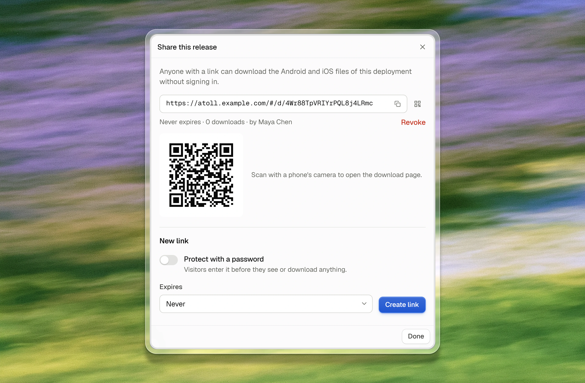
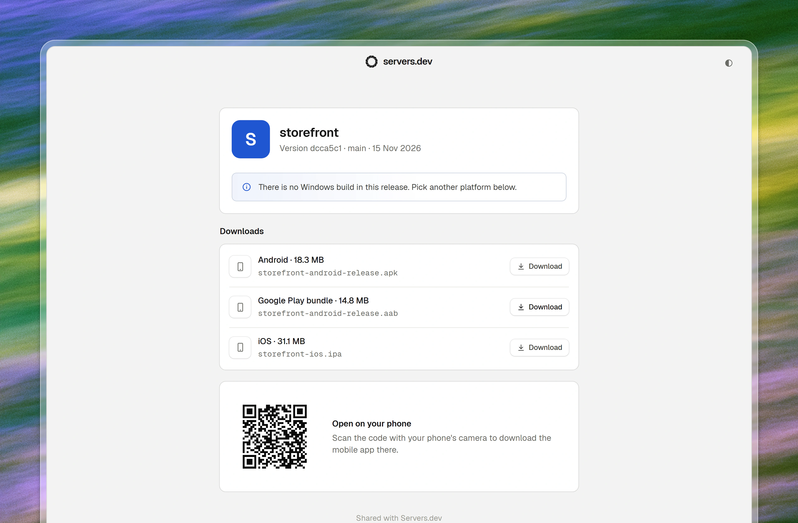

## Create a link

Open the deployment in the project's **Deployments** tab and press **Share** (it only shows when the deployment has app files). Choose:

| Option | Effect |
|--------|--------|
| Password | Visitors enter it before they see or download anything. 4 to 128 characters; share it separately from the link. |
| Expires | Never, or after 1, 7 or 30 days. The API accepts 1 hour to 365 days. |

Each link is a random address on the panel, `https://<panel>/#/d/<token>`. Copy it or show its QR code. A deployment can have up to 20 active links.

Creating and revoking links needs the **Developer** role; anyone who can see the project can list them.

## The download page

The page shows the app (the project name), its version (the commit, or the deployment id for uploads) and a big download button for the visitor's device: the APK on Android, the installer on Windows (`.msi`/`.exe`), macOS (`.dmg`/`.pkg`) and Linux (`.deb`, archive or jar). The other platforms are listed below. On a computer, a QR code opens the page on a phone.

Android App Bundles (`.aab`) are listed for Google Play but never offered first, because phones can't install them.

## When a link stops working

- **Revoked** by a project member.
- **Expired**.
- **Files deleted**: the platform keeps the files of the last 10 finished deployments per environment. When older ones are cleaned up, their links are revoked.
- **Project deleted**: its links are removed.
- **Paused**: while the project is suspended (free allowance used up or spend limit reached) the page says downloads are unavailable.

## Billing

Downloads through a link count as the project's bandwidth (`BANDWIDTH_GB`).

## Security

- Tokens carry 128 random bits. Passwords are stored as Argon2id hashes, like account passwords.
- The right password is exchanged for a download grant valid for 30 minutes, signed with a key of its own link (HMAC-SHA256), so it works on every server replica and dies with the link.
- Password attempts are limited to 10 per 15 minutes per link and address, and 100 per hour per link.
- Only the deployment's app files are served, never its source or other outputs.

## API

| Request | Who | |
|---------|-----|---|
| `GET /api/projects/{project}/share-links?deployment={id}` | Viewer | List links, newest first |
| `POST /api/projects/{project}/share-links` | Developer | `{"deploymentId", "password"?, "expiresInHours"?}` |
| `DELETE /api/projects/{project}/share-links/{id}` | Developer | Revoke |
| `GET /api/d/{token}?grant=` | Anyone | The page's data: `state` and, once available, the release and its files |
| `POST /api/d/{token}/unlock` | Anyone | `{"password"}` → `{"grant", "expiresAt"}` |
| `GET /api/d/{token}/files/{name}?grant=` | Anyone | Download one file; 410 once the link expired or was revoked |

## Settings

| Variable | Default | |
|----------|---------|---|
| `ATOLL_DISTRIBUTION_GRANT_MINUTES` | `30` | How long a password unlocks downloads |
| `ATOLL_DISTRIBUTION_MAX_LINKS` | `20` | Active links per deployment |
| `ATOLL_AUTH_TRUST_FORWARDED` | `false` | Shared with sign-in: take the client address for rate limits from `X-Forwarded-For` |
| `ATOLL_PANEL_URL` | public URL | Where links point |
