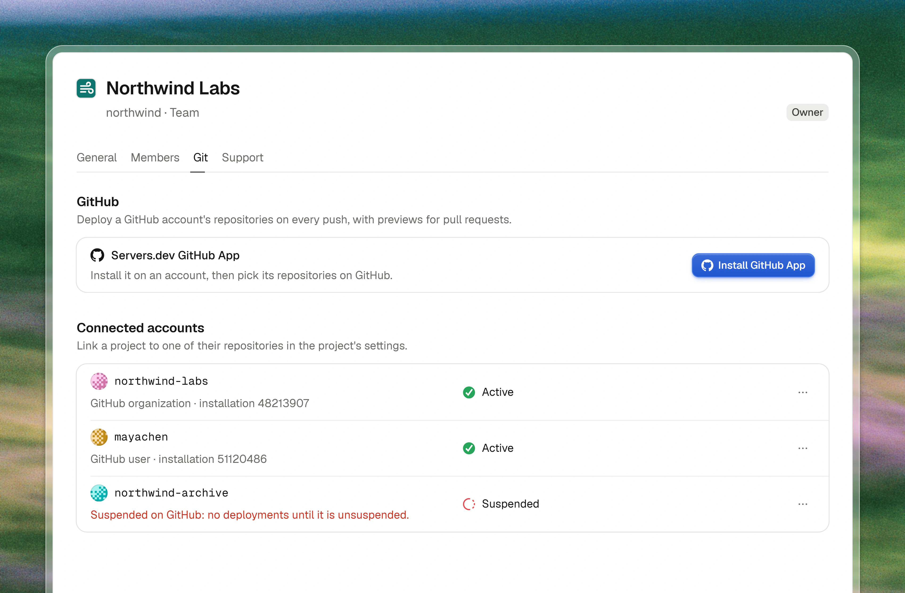

Link a project to a GitHub repository and the platform deploys it on every push to the production branch. Every pull request
gets its own [preview](/deploy/previews), and the platform reports progress back on the commit and the pull request.

## 1. Connect a GitHub account

An admin or owner of the org does this once per GitHub account:

1. Open the org in the panel, then the **Git** tab.
2. Click **Install GitHub App**. GitHub asks which account (your user or a GitHub organization) and which
   repositories the platform may access, and asks you to authorize the app.
3. GitHub sends you back to the **Git** tab, where the account is now listed.

The platform only connects an installation that you administer on GitHub: for a GitHub organization you must be one of its
**owners**, for a personal account it must be **your own**. It also has to be finished by the user who clicked
**Install GitHub App**, within 15 minutes. That way nobody can connect someone else's repositories to their org.

If you aren't an owner of the GitHub organization, GitHub asks an owner to approve the installation. Once it is
approved, an owner of that organization who is also an admin of the org clicks **Install GitHub App** and picks
the same account to connect it.

The same GitHub account can be connected to several orgs; each one goes through these steps.
**Repositories on GitHub** next to an account opens its installation settings, where you choose which repositories
the platform can see. **Disconnect** removes it from the org and unlinks the org's projects that use it; the app
stays installed on GitHub until you uninstall it there.

## 2. Link a project

Open the project's **Settings** tab and find **Git repository**:

| Setting | Meaning | Default |
|---------|---------|---------|
| GitHub account | A connected account of the project's org | the first one |
| Repository | Search the repositories the app can access | – |
| Production branch | Pushes to this branch deploy to production | the repository's default branch |
| Root directory | Where `settings.gradle.kts` is, for monorepos, e.g. `apps/shop` | the repository root |

Linking and unlinking need the **Admin** role. Your own GitHub account must also be able to access the repository
through the installation: the first time you link (and again after an hour), the panel asks you to **Authorize on
GitHub**, which returns you to the project. The platform keeps that authorization, encrypted, for at most an hour and only
uses it to check which repositories you may link.

A repository can be linked to several projects, for example one per root directory of a monorepo.

**Unlink** stops reacting to pushes and pull requests and removes the project's open previews. Production
deployments stay as they are. Deleting the project removes the link too.

## What deploys when

| On GitHub | In the platform |
|-----------|----------|
| Push to the production branch | Production deployment of that commit |
| Push to another branch, tag, branch deleted | Nothing |
| Pull request opened, reopened or new commits pushed | Preview deployment, preview key `pr-<number>` |
| Pull request closed or merged | The preview is removed |
| Pull request from a fork | Nothing until a maintainer adds the label `atoll-preview` |

The platform downloads the exact commit from GitHub, keeps only the root directory, and deploys it like an upload with
`atoll deploy`, including the same size limit. Symlinks are kept when they point inside the root directory (such as a
shared `gradlew`); others are left out. The deployment records the branch, commit, commit message (the pull request
title for previews) and pull request number. Git deployments have no "created by" user.

Only the newest commit deploys. Right before it starts a deployment, the platform checks that the commit is still the head of
the production branch (or of the open pull request). When you push twice in a row, the first push is skipped if the
second one already arrived, so an older commit never replaces a newer one in production.

### Pull requests from forks

Code from a fork hasn't been reviewed, so the platform doesn't build it on its own. The commit gets a pending status
explaining that a maintainer can add the label **`atoll-preview`** to the pull request. Only people with write access
to the repository can add labels, so adding it is the approval.

The label approves the commit that is the pull request's head when it is added. When the fork pushes more commits,
they wait again: remove the label and add it once more to build them. Labels on closed pull requests do nothing.

Previews from forks never get [secret env vars](/reference/env); non-secret ones are passed as usual.

## Feedback on GitHub

Every commit the platform deploys gets a commit status named `atoll/<project>`:

| Deployment | Status |
|------------|--------|
| Queued, building, deploying | pending |
| Live | success |
| Failed | failure, with the error |
| Partial: some targets live, some failed | failure, "Partial deployment" with the error |
| Cancelled | error |
| Refused, e.g. a used-up free allowance or a reached spend limit | failure, with the reason |
| Source couldn't be prepared, e.g. a missing root directory or too large | failure or error, with the reason |

**Details** on the status opens the project's deployments in the panel.

Pull requests also get one comment per project with the preview's status and URLs. The platform updates that comment in
place as new commits deploy, and notes when the preview is removed.

## Keeping links up to date

The platform follows changes on GitHub on its own:

- A renamed or transferred repository keeps its links.
- When the app loses access to a repository, or the repository is deleted, projects linked to it are unlinked and
  their open previews removed.
- When the app is uninstalled, every connection and link through it is removed. A suspended installation is shown
  as suspended and deploys nothing until it is unsuspended.
- Deleting an org removes its connections.
- Closing a pull request removes its previews even if the project was linked to another repository meanwhile.
  Statuses and comments always go to the repository a deployment came from.

## For operators: create the GitHub App

Git integration is off until the server has a GitHub App. Without one, the git routes answer 404 and the panel shows
the Git tab as off.

1. On GitHub, open **Settings → Developer settings → GitHub Apps → New GitHub App** (under a GitHub organization's
   settings to own it there).
2. Fill in:

   | Field | Value |
   |-------|-------|
   | Homepage URL | your panel URL |
   | Callback URL | `https://<api host>/api/git/github/setup` (first in the list; also used when users authorize the app to link) |
   | Request user authorization (OAuth) during installation | **on** (required) |
   | Setup URL | leave empty (with the option above, GitHub uses the callback URL) |
   | Redirect on update | on |
   | Webhook URL | `https://<api host>/api/webhooks/github` |
   | Webhook secret | a long random string, e.g. `openssl rand -hex 32` |

   The API host is `ATOLL_PUBLIC_URL`, where `/api` is served.
3. Repository permissions: **Contents** read-only, **Metadata** read-only, **Pull requests** read and write,
   **Commit statuses** read and write. Organization permissions: **Members** read-only, so the platform can check that the
   user connecting an installation owns the GitHub organization.
4. Subscribe to events: **Push**, **Pull request**, **Repository**. Installation and installation repositories
   events are always sent to apps.
5. Choose whether other accounts may install the app (**Any account** for a public install).
6. Create the app, then generate a private key (a `.pem` file) and a client secret.

Then give the server these settings:

| Variable | Value |
|----------|-------|
| `ATOLL_GIT_GITHUB_APP_ID` | the app's App ID |
| `ATOLL_GIT_GITHUB_APP_SLUG` | the app's URL name, from `https://github.com/apps/<slug>` |
| `ATOLL_GIT_GITHUB_PRIVATE_KEY` | the `.pem` contents (`\n` escapes are accepted) |
| `ATOLL_GIT_GITHUB_PRIVATE_KEY_FILE` | or a path to the `.pem` file |
| `ATOLL_GIT_GITHUB_WEBHOOK_SECRET` | the webhook secret |
| `ATOLL_GIT_GITHUB_CLIENT_ID` | the app's Client ID |
| `ATOLL_GIT_GITHUB_CLIENT_SECRET` | the client secret |
| `ATOLL_GIT_GITHUB_API_URL` | optional, default `https://api.github.com`; `https://<host>/api/v3` for GitHub Enterprise Server |
| `ATOLL_GIT_GITHUB_WEB_URL` | optional, default `https://github.com`, or the Enterprise host when the API URL ends in `/api/v3` |

The server refuses to start when only some of them are set. With the Helm chart, put the secrets in the secret named
by `features.git.existingSecret` and the rest under `features.git.config`.

The server needs outbound HTTPS to the API URL, the web URL and `codeload.github.com` (where source downloads are
redirected). Webhook deliveries are checked against `X-Hub-Signature-256`, and each delivery is handled once. When
part of a delivery fails because GitHub couldn't be reached (the commit gets an `error` status), redeliver it from the
app's **Advanced** settings on GitHub: only the projects that failed are retried.
