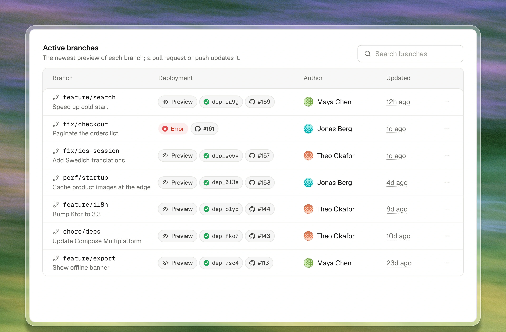

## How previews are created

Previews come from [git integration](/deploy/git). Once a project is linked to a GitHub repository:

- Every pull request gets a preview, keyed by its number: `pr-42`.
- Every push to the pull request deploys a new preview with the same key. It replaces the previous one.
- Pull requests from forks are not built until a maintainer adds the label `atoll-preview`. Their previews never get secret env vars.

Pushes to the production branch deploy to production, not to a preview. `atoll deploy` always deploys to production too.



## Hosts

Each preview key gets its own hosts. For project `my-app` and preview `pr-42`:

| What | Host |
|------|------|
| The primary Ktor module | `my-app--pr-42--app.atoll.app` |
| Every Ktor module | `my-app--pr-42--app-api.atoll.app` |
| The primary web module | `my-app--pr-42--web.atoll.app` |
| Other web modules | `my-app--pr-42--web-dashboard.atoll.app` |

A host name that would be longer than 63 characters is shortened to the project name and a hash, e.g. `my-app--3f2a9c1b7d4e6f80--app.atoll.app`. The URLs are on the deployment: in the panel, in `atoll list`, and in the platform's comment on the pull request.

A preview never replaces or removes anything in production. [Custom domains](/configure/custom-domains) only serve production.

## Env vars for previews

Env vars are set per environment: `production` or `preview`. Previews use the `preview` values, so you can point them at a test database or a sandbox API key:

```sh
atoll env set FEATURE_FLAGS=beta --env preview
atoll env import .env.preview --secret --env preview
```

See [Environment variables](/configure/environment-variables).

## Logs

Read the output of a preview's Ktor server by passing one of its deployments:

```sh
atoll logs --project my-app --deployment 3c9e41a0 --follow
```

## When a preview goes away

When the pull request is closed or merged, the platform removes its preview: the apps stop, the hosts stop answering, and the pull request comment says so.

## Promoting a preview

A preview that works can go to production as it is, without a rebuild:

```sh
atoll promote 3c9e41a0 --to production
```

See [Promote and rollback](/deploy/promote-and-rollback). Previews share one retention window: the platform keeps the files of the last 10 finished preview deployments of a project, across all its pull requests, plus the live ones.

## Billing

Previews use the same meters as production: build minutes, CPU, memory, bandwidth and storage. See [Billing](/teams/billing).
