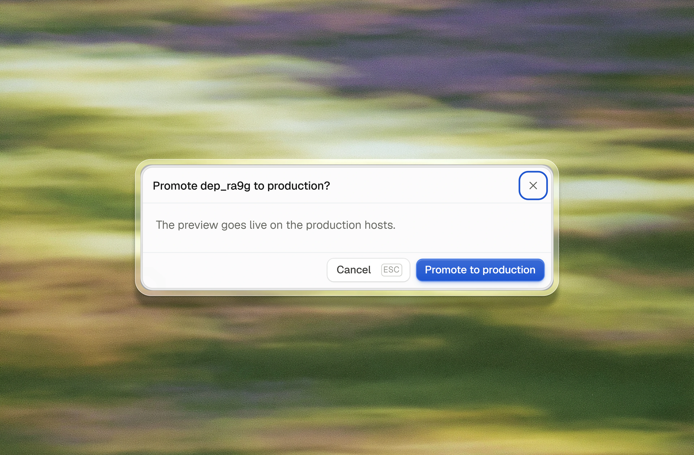

## Promote a deployment

```sh
atoll promote 3c9e41a0
```

The platform creates a new deployment that reuses the build outputs of `3c9e41a0`. The new deployment:

- runs with the project's **current** runtime env vars, so it also applies env var changes without a build;
- stays in the environment of `3c9e41a0`: production stays production, and a preview replaces the same preview;
- records where it came from, shown as "promoted from 3c9e41a0" in the CLI and the panel;
- goes through the usual statuses and ends as `READY`, `PARTIAL` or `FAILED`.

Without a rebuild you can promote a `READY` or `PARTIAL` deployment. With `--rebuild` (below), any finished one works, also a `FAILED` or `CANCELLED` one. Either way its files must still be kept: the last 10 finished deployments per project and environment, plus everything live. For older ones the platform answers "The files of deployment … are no longer kept"; deploy again instead.

The CLI waits for the new deployment and exits like `atoll deploy`; `--no-wait` returns right away. You need the Developer role.

## Promote a preview to production

A [preview](/deploy/previews) stays in the preview environment unless you say otherwise:

```sh
atoll promote 3c9e41a0 --to production
```



The other way round is not possible: a production deployment can't become a preview.

Build env vars are baked into the outputs when they are built. A preview built with `preview` build values keeps them when promoted. If your web app reads an API URL at build time, rebuild instead (next section).

## Rebuild

`--rebuild` builds the kept source of the deployment again, with the current build env vars of the environment it goes to:

```sh
atoll promote 3c9e41a0 --to production --rebuild
```

Use it after you change build env vars, or to move a preview to production with production build values.

## Roll back

```sh
atoll rollback
```

`atoll rollback` goes back to the previous good production build. It promotes the newest `READY` production deployment before the current one that runs different build outputs, so promotions of the current build are passed over. It does not rebuild. It uses the project in the current directory; pass `--project` (or `-p`) to name another one:

```sh
atoll rollback --project my-app
```

To go back further, find the deployment with `atoll list` and promote it:

```sh
atoll list -p my-app -e production
atoll promote b71f0c22
```

## Redeploy

Promoting the latest deployment redeploys it. That restarts its Ktor servers with the current env vars, which is the quickest way to apply a runtime env var change. The **Redeploy production** button in the panel's **Environment** tab does exactly that.
