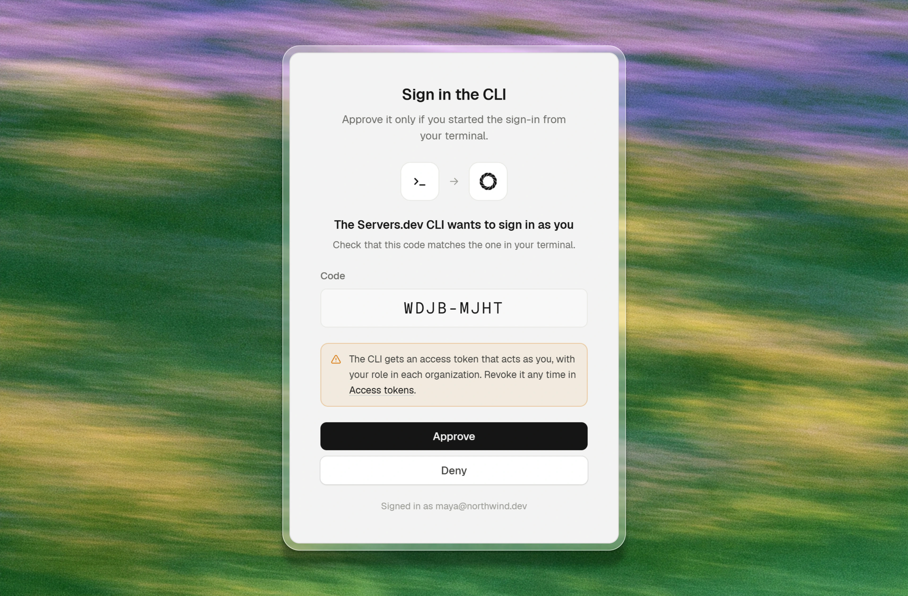

## What you need

- A Gradle project with the Gradle wrapper (`gradlew`) at its root. The platform builds with your wrapper, so it uses your Gradle version.
- At least one target the platform can deploy: a Ktor server, a web app, an Android app or a Compose Desktop app. See [Project structure](/project-structure).
- An account. The platform is in early access; ask for an invite on the home page.

## Deploy your first app

<Steps>
  <Step title="Install the CLI">
    The `atoll` CLI is a single native binary for Linux, macOS and Windows. There is no download yet, so build it from the platform's source repository with the link task for your system:

    <Tabs>
      <Tab title="Linux">
        ```sh
        ./gradlew :cli:linkReleaseExecutableLinuxX64     # x64
        ./gradlew :cli:linkReleaseExecutableLinuxArm64   # arm64
        ```
      </Tab>
      <Tab title="macOS">
        ```sh
        ./gradlew :cli:linkReleaseExecutableMacosArm64   # Apple silicon, only on a Mac
        ```
      </Tab>
      <Tab title="Windows">
        ```sh
        ./gradlew :cli:linkReleaseExecutableMingwX64
        ```
      </Tab>
    </Tabs>

    The binary ends up in `cli/build/bin/<target>/releaseExecutable/`: `atoll.kexe` on Linux and macOS, `atoll.exe` on Windows. Rename it to `atoll` (or keep `atoll.exe`), put it on your `PATH`, and check that it runs:

    ```sh
    atoll --version
    ```
  </Step>
  <Step title="Sign in">
    Sign in to your server:

    ```sh
    atoll login --server https://atoll.example.com
    ```

    The CLI prints a URL and a short code, and opens the panel in your browser. Check that the code matches and approve the sign-in. The CLI saves a token and remembers the server, so later commands need neither. `atoll whoami` shows who you are signed in as, and `atoll status` checks that the server answers.

    

    <Tip>
      In CI, skip `atoll login` and pass a personal access token instead. See [Deploying from CI](/deploy/cli#deploying-from-ci).
    </Tip>
  </Step>
  <Step title="Deploy">
    Run `atoll deploy` in the root of your project:

    ```sh
    cd my-app
    atoll deploy
    ```

    The CLI packages your source, uploads it and prints the build log as it runs. At the end it prints one line per target:

    ```text
    Deployment 3c9e41a0-5d2b-4f7e-9a61-0b8d2c7e4f15 READY

      KTOR  :server  READY  primary  https://my-app.atoll.app/
    ```

    Open the URL. Your server is live.
  </Step>
</Steps>

## Naming the project

The project is named after the directory. If the directory name is not a valid project name, pass one with `--name`:

```sh
atoll deploy --name my-app
```

A new project goes to your personal org. To put it in a team's org, pass `--org <slug>` or pick a default with `atoll orgs switch <slug>`.

## Next steps

<CardGroup cols={2}>
  <Card title="Add more targets" icon="layer-group" href="/project-structure">
    Add a web app or an Android app to the same build. The next deploy picks them up.
  </Card>
  <Card title="Set environment variables" icon="sliders" href="/configure/environment-variables">
    Give your server its configuration and secrets.
  </Card>
  <Card title="Link a GitHub repository" icon="code-branch" href="/deploy/git">
    Every push deploys and every pull request gets a preview.
  </Card>
  <Card title="Invite your team" icon="users" href="/teams/teams">
    Add members to an org and give them roles.
  </Card>
</CardGroup>
