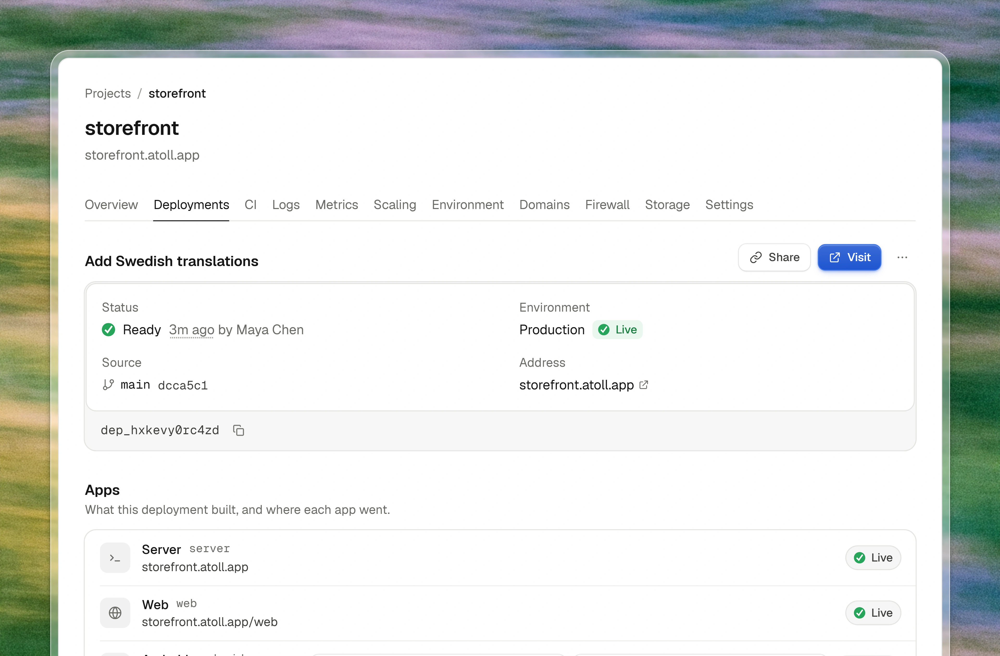

The platform deploys Kotlin Multiplatform and Ktor projects. You point it at a Gradle build, and it finds every target in it: Ktor servers, web apps, Android apps and desktop apps. It builds them in one go and puts them live.

## Start here

<CardGroup cols={3}>
  <Card title="Getting started" icon="rocket" href="/getting-started">
    Go from an empty terminal to a live app in a few minutes.
  </Card>
  <Card title="Project structure" icon="sitemap" href="/project-structure">
    How the platform finds the targets in your build and which hosts they get.
  </Card>
  <Card title="Deploy with the CLI" icon="terminal" href="/deploy/cli">
    `atoll deploy`, its output and its exit codes.
  </Card>
</CardGroup>

## What you can deploy

<CardGroup cols={3}>
  <Card title="Ktor servers" icon="server" href="/targets/server">
    Your server on its own host, with replicas added as the load goes up.
  </Card>
  <Card title="Web apps" icon="globe" href="/targets/web">
    Wasm and JS builds served as a static site on their own URL.
  </Card>
  <Card title="Android apps" icon="mobile" href="/targets/android">
    A signed APK and App Bundle with every deploy, and Google Play uploads.
  </Card>
  <Card title="Desktop apps" icon="desktop" href="/targets/desktop">
    Compose Desktop packages attached to every deployment.
  </Card>
  <Card title="iOS apps" icon="mobile-screen-button" href="/targets/ios">
    Unsigned simulator builds on a macOS build runner.
  </Card>
</CardGroup>

## How the platform works

<Steps>
  <Step title="Start a deployment">
    Run `atoll deploy`, or push to a GitHub repository linked to the project.
  </Step>
  <Step title="The platform reads your build">
    It reads your Gradle build and lists the targets it can deploy.
  </Step>
  <Step title="It builds every target">
    It builds them with your project's own Gradle wrapper.
  </Step>
  <Step title="Your apps go live">
    Ktor servers start on their own hosts, web apps are served from theirs, and Android and desktop builds are attached to the deployment as downloads.
  </Step>
</Steps>

Each run is a [deployment](/deploy/deployments). It ends as `READY`, `PARTIAL`, `FAILED` or `CANCELLED`.

## Run it in production

<CardGroup cols={3}>
  <Card title="Scaling" icon="gauge-high" href="/run/scaling">
    Size, replicas and scale to zero for each Ktor server.
  </Card>
  <Card title="Storage" icon="database" href="/storage/overview">
    Managed Postgres, Redis and Files stores, connected to your projects.
  </Card>
  <Card title="Logs and metrics" icon="chart-line" href="/observe/metrics">
    Runtime logs, request and resource charts, and the overview dashboards.
  </Card>
  <Card title="Regions" icon="earth-europe" href="/run/regions">
    Pick where a project's Ktor servers run.
  </Card>
  <Card title="Build runners" icon="hammer" href="/run/runners">
    Build Windows and macOS installers and iOS apps on your own machines or the platform's.
  </Card>
  <Card title="Firewall" icon="shield-halved" href="/configure/firewall">
    Rules, IP blocking, managed rulesets and attack mode.
  </Card>
</CardGroup>

## Help

Read the [FAQ](/faq), or email hello@atoll.app.
