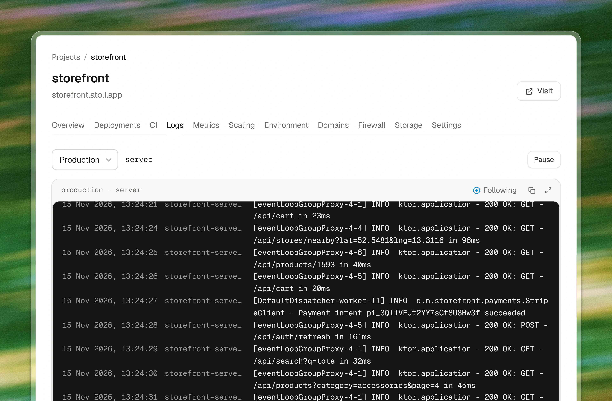

## Build logs and runtime logs

The platform has two kinds of logs:

| | Build log | Runtime log |
|---|-----------|-------------|
| What it holds | The Gradle build and the rollout of each target of one deployment | What a running Ktor server prints |
| Where you read it | **Build logs** on the deployment's page, `atoll logs <id>` | The project's **Logs** tab, `atoll logs --project <name>` |
| How long it stays | As long as the deployment record | Only while the replica that printed it runs |

This page is about runtime logs. For build logs, see [Deployments](/deploy/deployments#logs).

Only [Ktor servers](/targets/server) have runtime logs. Web apps are static files, and Android, desktop and iOS apps run on your users' devices.

## Where runtime logs come from

A runtime log is everything your server writes to standard output and standard error, line by line. Log to the console, and your lines show up. Lines your server writes to a file do not.

A module can run several replicas. The platform reads all of them and merges their lines in time order. Each line shows:

- the time it was printed;
- the replica that printed it, for example `my-app-7d9c5b8f6-x2kqp`;
- the text.

A replica that is still starting shows the line `(no logs from this replica yet)` once.

The platform keeps no archive of runtime logs. It reads them from the replicas that run now. Once a replica is gone, for example because a new deployment replaced it or the module scaled down, you can't read its output from the platform any more.

<Tip>
On a self-hosted server with the monitoring stack and its logs turned on, Loki keeps the logs of every pod for the configured retention, and you can search them in Grafana. See [Monitoring](/self-hosting/monitoring#logs).
</Tip>

## Secret values are masked

The platform replaces the values of [secret env vars](/configure/environment-variables#secrets) with `****` before it shows you a line. It masks both the current values and the ones the replica was started with, so a secret you changed since stays hidden. Values shorter than 4 characters are not masked.

If the platform can't check the secret values, it shows no lines at all rather than risk showing a secret. You get this message instead:

```text
Runtime logs are unavailable because secret env vars could not be checked; try again shortly
```

## In the panel

Open the project and pick the **Logs** tab.



- **Environment.** **Production** is shown first. When the project has previews, a menu lists **Preview** followed by each preview key, such as **Preview pr-42**.
- **Module.** When more than one Ktor module runs, pick one. The tab opens on the [primary module](/primary-module).
- **Follow** and **Pause.** While following, the tab fetches new lines every 2 seconds and stays scrolled to the end. **Pause** stops fetching, so you can read without the lines moving. **Follow** fetches right away and starts again.
- **Copy log** copies every line in the tab, with its time and replica. The full-screen button opens the log over the whole window.

The tab starts with the last 200 lines and keeps up to 5,000. Older lines drop off the top.

If no Ktor module runs in the chosen environment, the tab says so, for example `No Ktor module of 'my-app' is running in production`.

You also reach the tab from the **Production** card on the project's [Overview](/observe/overview#a-projects-overview-tab) tab, in its menu.

## With the CLI

```sh
atoll logs --project my-app                            # last 200 lines of the primary module
atoll logs --project my-app --follow                   # keep printing new lines
atoll logs --project my-app --module :admin            # another module
atoll logs --project my-app --deployment 7f3a2c1e -f   # the preview that deployment 7f3a2c1e belongs to
```

| Option | Meaning |
|--------|---------|
| `-p`, `--project <name>` | The project whose running Ktor server you want to read. Required for runtime logs. |
| `-m`, `--module <path>` | The Ktor module, for example `:admin`. Use `root` for a server in the root project. Default: the [primary module](/primary-module). |
| `-d`, `--deployment <id>` | Read the preview that this deployment belongs to instead of production. The start of the id is enough if it matches one of your 200 newest deployments. |
| `-f`, `--follow` | Keep printing new lines, checking every 2 seconds, until you press Ctrl+C. |

The [global options](/reference/cli#global-options) `--server` and `--token` work here too. Pass either `--project` or a deployment id, not both: a deployment id alone prints that deployment's build log.

The output starts with the module it reads and the other modules that run, then one line per log line with your machine's local time, the replica and the text:

```text
Runtime output of :server (also running: :admin)
14:02:11  my-app-7d9c5b8f6-x2kqp  Application started in 0.412 seconds.
14:02:11  my-app-7d9c5b8f6-x2kqp  Responding at http://0.0.0.0:8080
14:02:19  my-app-7d9c5b8f6-x2kqp  200 OK: GET - /
```

The first line goes to standard error, so a pipe only gets the log lines. There is no filter option; use your shell instead:

```sh
atoll logs -p my-app -f | grep ERROR
```

If the module you ask for doesn't run, the error lists the ones that do:

```text
Ktor module ':admin' is not running in production of 'my-app' (running: :server)
```

## Who can read logs

Every member of the project's org can read its runtime logs. Reading needs the Viewer role. See [Teams and roles](/teams/teams#roles).
