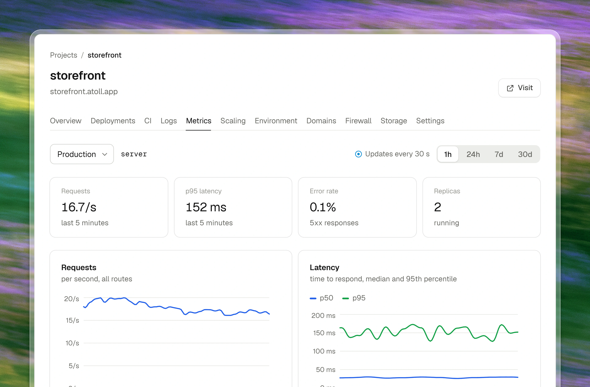

## What you need

- **A Ktor module that runs.** Metrics are for [Ktor servers](/targets/server). Web apps are static files and have no metrics here.
- **Monitoring on the server.** The platform reads metrics from Prometheus. If the server has none, the **Metrics** tab shows **Metrics aren't available** with the reason:

  ```text
  Metrics need a monitoring stack (Prometheus), and this server has none set up.
  ```

  To set it up on your own server, see [Monitoring](/self-hosting/monitoring#app-metrics).

## Open the Metrics tab

Open the project and pick the **Metrics** tab. The toolbar has three pickers:

- **Environment.** **Production**, or a preview such as **Preview pr-42**. The menu shows up when a preview has a Ktor module running.
- **Module.** When more than one Ktor module runs, pick one. The tab opens on the [primary module](/primary-module).
- **Range.** `1h`, `24h`, `7d` or `30d`. The tab opens on `1h`.



Every member of the project's org can see its metrics. It needs the Viewer role.

## Current values

Four tiles at the top show the module right now:

| Tile | What it shows |
|------|---------------|
| **Requests** | Requests per second, over the last 5 minutes. |
| **p95 latency** | The time 95% of requests took at most, over the last 5 minutes. "no requests" when there were none. |
| **Error rate** | The share of responses with a 5xx status, over the last 5 minutes. |
| **Replicas** | How many replicas run. **Sleeping** when the module has scaled to zero. |

When a module scaled to zero, a note says it starts again on the next request. See [Scale to zero](/run/scaling#scale-to-zero).

## Charts

Six charts show the chosen range:

| Chart | What it shows |
|-------|---------------|
| **Requests** | Requests per second, all routes together. |
| **Latency** | Time to respond: the median (p50) and the 95th percentile (p95). |
| **Error rate** | The share of responses with a 5xx status. 4xx responses don't count as errors. |
| **Replicas** | Ready replicas. 0 while the module scales to zero. |
| **CPU** | vCPU in use, added up over all replicas. |
| **Memory** | Memory in use (the working set), added up over all replicas. |

Requests, latency and errors are measured at the platform's router, for the requests that reach the module through its hosts and, in production, its [custom domains](/configure/custom-domains). Hover over a chart to read the value at a point. Where there was no data, for example latency while there were no requests, the line has a gap.

## Time ranges

| Range | One point every | Updates on its own |
|-------|-----------------|--------------------|
| `1h` | 30 seconds | Every 30 seconds |
| `24h` | 5 minutes | Every 60 seconds |
| `7d` | 30 minutes | No |
| `30d` | 2 hours | No |

Each point is an average over the time before it: one step, and at least 2 minutes. While a range updates on its own, the toolbar says so, for example **Updates every 30 s**. To see newer points in `7d` or `30d`, reload the page.

The server keeps answers for a short while, so figures can be a little behind: up to 15 seconds for the last hour, and up to 10 minutes for the last 30 days.

<Note>
Charts only reach back as far as the server's Prometheus keeps data. A self-hosted server keeps 15 days by default, so the `30d` range shows nothing older than that. See `monitoring.retention` in [Configuration](/self-hosting/configuration).
</Note>

## Previews

Pick a preview in the environment menu to see its Ktor modules. The menu lists the previews that have a Ktor module running. When a preview goes away, it drops out of the list.

## When the tab is empty

| Message | Why |
|---------|-----|
| **Metrics are for Ktor modules** | The project only has web apps. |
| **No Ktor modules running** | Nothing runs in production yet. Deploy the project. |
| **No Ktor modules in this preview** | The chosen preview runs no Ktor module. Pick production or another preview. |
| **Metrics aren't available** | The server has no monitoring, or it could not read it. The reason is shown. |
| **Couldn't load metrics** | The request failed. Use **Retry**. |

If a refresh fails after the charts loaded, the charts stay and a banner says **Couldn't refresh**.

## Metrics in other places

- The project's **Overview** tab shows the last 24 hours of requests, p95 latency and error rate of the primary module. See [Overview dashboards](/observe/overview#a-projects-overview-tab).
- The org overview adds up traffic and errors across your live projects. See [Overview dashboards](/observe/overview#from-push-to-traffic).
- What you pay for, such as vCPU-hours, GB-hours and bandwidth, is on the org's **Billing** tab, not here. See [Billing](/teams/billing#usage-and-invoices).
