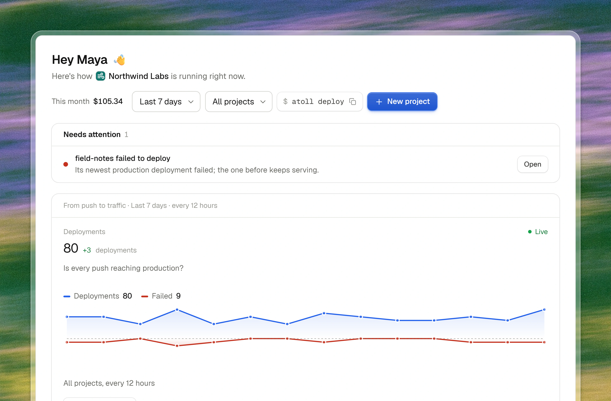
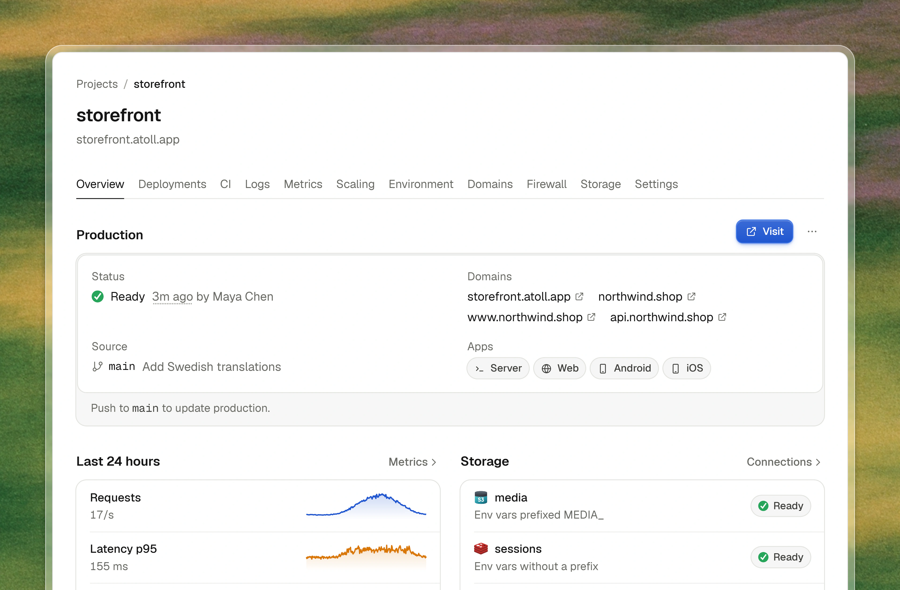

## The org overview

The panel opens on the org overview. You also reach it with the **Overview** tab at the top of the org's pages. Every member of the org sees it.

The header shows the org, its pages as tabs, and **This month** with the org's spend so far, which links to the **Billing** tab. Spend only shows when the server bills orgs; see [Billing](/teams/billing).

### Pick a period and a project

Under the header:

- **Period.** **Last 24 hours**, **Last 7 days** or **Last 30 days**. The overview opens on the last 7 days.
- **Project.** **All projects**, or one of them. Every figure on the page follows this choice.
- A button that copies `atoll deploy`, and **New project** if you have the Developer role.

The page updates on its own: deployments every 10 seconds, traffic and errors every 30 seconds.

### The note

One line under the toolbar says the most important thing first:

| Note | When |
|------|------|
| **Apps are stopped** | Billing stopped the org's apps. The reason is shown, with a link to **Billing**. See [What happens at a limit](/teams/billing#what-happens-at-a-limit). |
| **`my-app` failed to deploy** | A project's newest production deployment failed. The one before keeps serving. With several, it lists them. |
| **80% of this month's spend limit is used** | The org has used 80% or more of its [spend limit](/teams/billing#spend-limits). Only admins and owners see the limit, so only they get this note. |
| **Deploy from your terminal** | Nothing above applies. |

### From push to traffic

Three columns follow one change from a push to the requests it serves. Each draws one bar per part of the period:

| Period | Bars | One bar per |
|--------|------|-------------|
| Last 24 hours | 12 | 2 hours |
| Last 7 days | 14 | 12 hours |
| Last 30 days | 15 | 2 days |

Hover over a bar to see its time and figure.

- **Deployments.** How many deployments started in the period, production and previews, and the change from the period before. Failed deployments are the red part of each bar. When a project's newest production deployment failed, **Fix** followed by the project's name opens it.
- **Traffic.** How many requests the live projects served, and the highest request rate one of them reached. **View metrics** opens the [Metrics](/observe/metrics) tab of the busiest project.
- **Errors.** The share of requests that got a 5xx response, and how many there were. A button opens the [Logs](/observe/logs) tab of the project with the most failed requests.

The deployment count comes from the 200 newest deployments you can see. If those don't reach back to the start of the period, the figure starts with `≥`: there were at least that many.

Traffic and errors come from the same data as the **Metrics** tab, for the primary Ktor module of each live project, and the overview measures up to eight live projects. The totals are worked out from the request rate at each point, so read them as close estimates. Without monitoring on the server, both columns show grey bars marked **Needs metrics**, with the reason. See [Metrics](/observe/metrics#what-you-need).

### Projects

A table of the projects, busiest first, then the most recently deployed:

| Column | What it shows |
|--------|---------------|
| **Project** | The name, and its production URL, its GitHub repository or "CLI uploads". |
| **State** | See below. |
| **Requests** | Requests in the period. |
| **Errors** | The share of those that got a 5xx response. |
| **Latest deployment** | The status of the newest deployment and when it started. |
| **Trend** | Requests per part of the period, as small bars. |

A project's state comes from its newest deployment and what is live:

| State | Meaning |
|-------|---------|
| **Deploying** | The newest deployment hasn't finished. |
| **Failed** | The newest production deployment failed. An older one may still be live. |
| **Live** | Something is live in production. |
| **Not live** | Nothing is live in production yet. |

Click a row to open the project.

### Recent deployments

The 8 newest deployments of the projects shown, production and previews, with their status, who started them and when. Click a row to open the deployment's page and its build log.

### An empty org

An org without projects shows **Deploy your first project**, with the `atoll deploy` command and, for developers, **New project**. See [Getting started](/getting-started).

## A project's overview tab

**Overview** is the first tab of every project. It updates every 15 seconds.

### Production

One card shows what is live in production:

- **Status.** **Ready**, or **Partly live** when some targets failed, with how long ago it was deployed and by whom.
- **Domains.** The production URL and every active [custom domain](/configure/custom-domains).
- **Source.** The branch and the title of the live deployment.
- **Apps.** One chip per target. A chip with a URL opens it; the others open the deployment's page, where the downloads are.

**Visit** opens the production URL. The menu next to it has **Build logs**, **Deployments**, **Roll back**, **Repository on GitHub**, **Domains** and **Logs**.

Under the card, a line says how to update production: push to the production branch, or run `atoll deploy` for a project without a repository. Before the first deployment goes live, the card says **Not live yet**.

### Next steps

A checklist of setup steps, shown until every one is done:

- Connect a Git repository
- Go live in production
- Add a custom domain
- Deploy a preview
- Connect a data store

Each step opens the tab where you do it.

### Last 24 hours

Requests per second, p95 latency and error rate of the [primary module](/primary-module), with the latest value and a small chart of the last day. **Metrics** opens the [Metrics](/observe/metrics) tab. The section only shows when there are metrics for the module.

### Storage

The data stores the project is connected to, each with the prefix of its env vars and its status. It only shows when there is at least one.

### Active branches

The newest preview of each branch, with the preview's link, its status, its pull request or commit, who pushed it and when. Search by branch or title. Each row's menu has **Build logs**, **Visit preview** and **Open pull request**. See [Previews](/deploy/previews).
