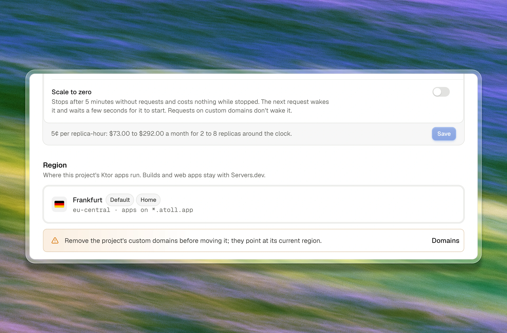

A region is a cluster where the platform runs Ktor servers. Each project runs in exactly one region, and all of its Ktor servers run there: production and previews.

Only the Ktor servers move with the region. Builds, [web apps](/targets/web) and downloads of Android and desktop files stay with the server, whatever region the project is in.

Which regions there are depends on your server. A server with one region has nothing to choose: every project runs there.

## See where a project runs

- The **Projects** list has a **Region** column with each project's flag and region id.
- A project's **Scaling** tab has a **Region** section at the bottom. It shows the region's flag, name and id, and the domain its apps are served on, for example `apps on *.apps.eu.example.com`.



A region can carry these badges:

| Badge | Meaning |
|-------|---------|
| **Default** | New projects go here unless you pick another region. |
| **Home** | The cluster the server itself runs in. |
| **Draining** | Keeps running its projects, but takes no new ones. |

## Choose a region for a new project

When you create a project in the panel with **New project**, the form has a **Region** field. It lists the regions that take new projects, with the default one picked. Pick another one if you like.

A project that `atoll deploy` creates goes to the default region. The CLI has no option for the region. To run it somewhere else, [move it](#move-a-project) after the first deployment.

## Hosts in a region

Each region serves its Ktor apps on its own domain. A project in a region whose apps domain is `apps.eu.example.com` gets:

- `my-app--<module>.apps.eu.example.com` for every Ktor module;
- `my-app.apps.eu.example.com` for the [primary module](/primary-module).

Web apps keep their hosts under the home domain, for example `my-app-web.atoll.app`, in every region. Outside the home region, the deployment log says where each Ktor module goes:

```text
Deploying :server to region eu-central
```

## Move a project

Moving a project rolls out its live production deployment again in the new region. The old region keeps serving until the new rollout is live. Then the platform removes the project's apps from the old region.

<Steps>
  <Step title="Check that nothing blocks the move">
    A project can't move while:

    - it has [custom domains](/configure/custom-domains), since they point at its current region. Remove them first, and add them again after the move.
    - it is connected to data stores, since they run in its current region. Disconnect them first.
    - a deployment of it is running. Wait for it to finish, or cancel it.

    The **Region** section shows a warning with the reason when one of these applies.
  </Step>
  <Step title="Pick the new region">
    Open the project's **Scaling** tab. In the **Region** section, pick a region under **Move to** and click **Move…**.
  </Step>
  <Step title="Confirm">
    The dialog says what happens. Click **Move project**.
  </Step>
</Steps>

After you confirm:

- If the project has a live production deployment, the platform starts a new production deployment of the same version in the new region. It reuses the built images when it can, and builds them again when it can't. The new deployment shows up on the **Deployments** tab like any other.
- While it rolls out, the **Region** section says "Moving here", and the apps in the old region keep serving.
- Once it is live, the platform removes the project's apps from the old region, previews included. A preview runs in the new region the next time it deploys.
- If the project has nothing live, the move only records the new region. The next deployment goes there.

<Warning>
  The URLs of the project's Ktor servers change to the new region's domain. Update clients that call the old hosts. Web app URLs stay the same.
</Warning>

Moving a project needs the Admin or Owner role in its org. See [Teams and roles](/teams/teams#roles). You can't move a project into a draining region.

<Accordion title="Move a project with the API">
  There is no CLI command for regions. With a [personal access token](/account/tokens):

  ```sh
  # The regions a project can go to
  curl -H "Authorization: Bearer $ATOLL_TOKEN" https://atoll.example.com/api/regions

  # Where a project runs, and why it can't move, if it can't
  curl -H "Authorization: Bearer $ATOLL_TOKEN" https://atoll.example.com/api/projects/my-app/region

  # Move it
  curl -X PUT -H "Authorization: Bearer $ATOLL_TOKEN" -H "Content-Type: application/json" \
    -d '{"region": "eu-central"}' https://atoll.example.com/api/projects/my-app/region
  ```

  The move answers the project's new region and, if the project had anything live, the deployment that rolls it out there. A blocked move answers HTTP 409 with the reason.
</Accordion>

## Regions and other settings

- [Scaling](/run/scaling) settings stay the same when a project moves.
- [Custom domains](/configure/custom-domains) of a project's Ktor servers point at its region. The panel shows the DNS records to create for it.
- Operators add regions and choose the default one. See [Running the platform on Kubernetes](/self-hosting/kubernetes#regions).
