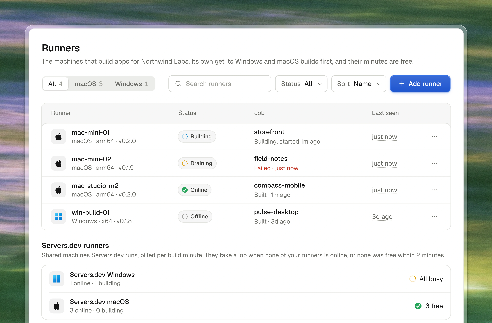

The platform builds on Linux. A few files can only be built on another operating system. A **build runner** is a Mac or a Windows machine that builds them for your deployments, with the `atoll-runner` program.

## What runners build

| Runner | Builds | See |
|--------|--------|-----|
| Windows | `.msi` and `.exe` installers | [Desktop apps](/targets/desktop) |
| macOS | `.dmg` and `.pkg` installers, iOS simulator apps (`.app.zip`) | [Desktop apps](/targets/desktop), [iOS apps](/targets/ios) |

Everything else builds on Linux: Ktor servers, web apps, Android apps, and the JAR, archive and `.deb` of desktop apps. You only need a runner for the files in the table.

## Your own runners and shared runners

There are two kinds of runners:

| | Your own runners | Shared runners |
|---|---|---|
| Who runs them | your org, on its own machines | the platform |
| Who adds them | the org's admins, on the **Runners** tab | the platform's operators |
| They build for | your org's projects only | every org that may use them |
| Billed | no | per build minute, by operating system |
| On the free plan | yes | no |

The org's **Runners** tab lists your own runners. Its **shared runners** section shows, per operating system, how many shared runners may build for your org right now: how many are online and how many are building. It shows counts only.



## Which runner builds a job

<Steps>
  <Step title="The build checks for runners">
    When a deployment's build starts, the platform checks which operating systems have an online runner that may build for your org. The build only prepares installers for those. For the others, the target gets a note instead.
  </Step>
  <Step title="The platform queues runner jobs">
    After the Linux build, the platform queues one runner job per operating system. On macOS the iOS app gets a job of its own, so a failing iOS build doesn't drop the `.dmg` and `.pkg`.
  </Step>
  <Step title="Your own runners go first">
    If one of your own runners for that operating system is online, shared runners leave the job alone for 2 minutes, so one of yours can take it. If none of yours is online, or all of them are draining, an shared runner may take the job at once.
  </Step>
  <Step title="The runner builds and uploads">
    The runner downloads the same source, builds it with the same build environment variables, and uploads the files. They join the target's files on the deployment.
  </Step>
</Steps>

When billing doesn't allow shared runners, only your own runners may take the job. That is the case on the free plan, at the [spend limit](/teams/billing#spend-limits), and when a failed payment wasn't fixed in time (see [What happens at a limit](/teams/billing#what-happens-at-a-limit)). The build log says so. If none of your own runners is online, the target gets a note.

The oldest waiting job goes first. A runner builds one job at a time; add more machines to build more at once.

The runner's output shows in the deployment's build log, with the operating system in front:

```text
[windows] Queued runner job rj_4f0c2a9e1b7d3c5a8e6f0b12 for :desktop (.msi, .exe)
[windows] A runner picked up the job
[windows] ==> downloading source
```

## When a runner doesn't build it

- If no runner takes the job within 15 minutes, the platform gives up on it.
- If a job runs longer than 60 minutes, it fails.
- If a runner stops responding for a minute during a build, the job goes back to the queue once. If that happens again, the job fails.
- If you [cancel the deployment](/deploy/deployments#cancelling), the runner stops the build within about 10 seconds.

Installers are extras. When they can't be built, the target is still deployed with what Linux built, and a note says what is missing:

```text
The Windows installers (.msi, .exe) could not be built: No Windows build runner available.
```

An iOS app is built only on a runner. Without one, the iOS target is `SKIPPED` with the reason. See [When the iOS target is skipped](/targets/ios#when-the-ios-target-is-skipped).

These are the default times. A self-hosted server can use others; see [Build runners](/self-hosting/runners#server-settings) for operators.

## Add your own runner

### What you need

- A Windows machine (Windows 10 or Server 2019 or newer, x64), or a Mac with Apple silicon.
- A JDK 17 or newer on `PATH` or in `JAVA_HOME`. The project's Gradle wrapper picks its own Gradle.
- On a Mac: Xcode and its command line tools, for `.dmg`, `.pkg` and iOS apps. On Windows, Compose downloads WiX itself.
- Outbound HTTPS to your server. Runners need no inbound ports.
- The Admin role in the org.

<Warning>
  Builds run on the machine itself, as the user that runs the agent, not in a virtual machine. Project code can read everything that user can, including the runner's token, and every build gets the project's build environment variables. Use a machine and a user that hold nothing else, and only build projects you trust.

  That is why your own runner only ever builds your org's projects. Executors that build in a fresh virtual machine per job (`hyperv` on Windows, `tart` on macOS) are not available yet, so you have to pass `--executor direct`.
</Warning>

### Set it up

<Steps>
  <Step title="Build atoll-runner">
    There is no download yet. Build `atoll-runner` from the platform's source repository, on the kind of machine it will run on:

    <Tabs>
      <Tab title="macOS">
        ```sh
        ./gradlew :runner:linkReleaseExecutableMacosArm64
        ```

        The binary is `runner/build/bin/macosArm64/releaseExecutable/atoll-runner.kexe`. Rename it to `atoll-runner` and put it on your `PATH`, for example in `/usr/local/bin`.
      </Tab>
      <Tab title="Windows">
        ```powershell
        .\gradlew.bat :runner:linkReleaseExecutableMingwX64
        ```

        The binary is `runner\build\bin\mingwX64\releaseExecutable\atoll-runner.exe`. Put it on your `PATH`, for example in `C:\Program Files\atoll-runner`.
      </Tab>
    </Tabs>

    Check that it runs with `atoll-runner --version`.
  </Step>
  <Step title="Create a registration token">
    Open your org, click the **Runners** tab, then **Add runner** and **Create registration token**. The token works once, for 24 hours, and is shown only now. The sheet shows the commands for the next steps with the token filled in; switch between macOS and Windows in a command's header.
  </Step>
  <Step title="Register the machine">
    On the machine, as the user the agent will run as:

    <CodeGroup>
      ```sh macOS
      atoll-runner register \
        --server https://atoll.example.com \
        --registration-token atreg_... \
        --executor direct
      ```

      ```powershell Windows
      atoll-runner register `
        --server https://atoll.example.com `
        --registration-token atreg_... `
        --executor direct
      ```
    </CodeGroup>

    This saves the runner's token in a file only that user can read: `~/.config/atoll-runner/runner.json` on macOS, `%ProgramData%\atoll-runner\runner.json` on Windows. Pass `--token-file` to put it somewhere else. The runner is named after the machine; pass `--name` to pick another name.
  </Step>
  <Step title="Start the agent">
    ```sh
    atoll-runner agent --executor direct
    ```

    The agent asks the platform for jobs and runs them. It prints a warning that the `direct` executor is not isolated. The runner shows up as **Online** on the **Runners** tab.
  </Step>
  <Step title="Keep it running">
    Optionally, run the agent as a service, so it starts with the machine. See [Run the agent as a service](#run-the-agent-as-a-service).
  </Step>
</Steps>

### Run the agent as a service

<Tabs>
  <Tab title="macOS">
    Create a user for the agent (here `atoll-runner`), and register the machine as that user. Then save this as `/Library/LaunchDaemons/app.atoll.runner.plist`:

    ```xml
    <?xml version="1.0" encoding="UTF-8"?>
    <!DOCTYPE plist PUBLIC "-//Apple//DTD PLIST 1.0//EN" "http://www.apple.com/DTDs/PropertyList-1.0.dtd">
    <plist version="1.0">
    <dict>
      <key>Label</key><string>app.atoll.runner</string>
      <key>UserName</key><string>atoll-runner</string>
      <key>ProgramArguments</key>
      <array>
        <string>/usr/local/bin/atoll-runner</string>
        <string>agent</string>
        <string>--executor</string>
        <string>direct</string>
        <string>--token-file</string>
        <string>/Users/atoll-runner/.config/atoll-runner/runner.json</string>
      </array>
      <key>RunAtLoad</key><true/>
      <key>KeepAlive</key><true/>
      <key>StandardOutPath</key><string>/var/log/atoll-runner.log</string>
      <key>StandardErrorPath</key><string>/var/log/atoll-runner.log</string>
    </dict>
    </plist>
    ```

    Load it:

    ```sh
    sudo launchctl bootstrap system /Library/LaunchDaemons/app.atoll.runner.plist
    ```
  </Tab>
  <Tab title="Windows">
    Create a local user for the service (here `atoll-runner`), and register the machine as that user. Then install the service with [NSSM](https://nssm.cc):

    ```powershell
    nssm install atoll-runner "C:\Program Files\atoll-runner\atoll-runner.exe" `
      agent --executor direct --token-file C:\ProgramData\atoll-runner\runner.json
    nssm set atoll-runner ObjectName .\atoll-runner <password>
    nssm start atoll-runner
    ```
  </Tab>
</Tabs>

## Labels

A runner has labels, `key=value` pairs. `os` is required: `macos` or `windows`. By default a runner gets the `os` and `arch` of its machine, for example `os=macos,arch=arm64`. Set others with `--labels` when you register. `--labels` replaces the defaults, so include `os`:

```sh
atoll-runner register --server https://atoll.example.com --registration-token atreg_... \
  --executor direct --labels os=macos,arch=arm64,site=office
```

Jobs go to runners by their `os` label. The **Runners** tab shows each runner's operating system, architecture and `atoll-runner` version.

## iOS builds

A macOS runner tells the platform that it can build iOS apps: it announces the `ios` capability every time it asks for a job. iOS jobs only go to runners that announce it. Installer jobs go to any macOS runner.

Older versions of `atoll-runner` don't announce it. They keep building the `.dmg` and `.pkg`, but don't take iOS jobs. If those are the only macOS runners online, the iOS target is skipped with:

```text
The iOS app (.app.zip) could not be built: The macOS build runners available to this project are too old for it; update atoll-runner on them.
```

Build a new `atoll-runner`, replace the old binary and restart the agent. The runner needs Xcode to build the app. See [iOS apps](/targets/ios) for what the project needs.

## Manage runners

Every member of the org can see its runners on the **Runners** tab. Filter them by operating system with the tabs, search them, filter by **Status** and sort by **Name** or **Last seen**. Each row shows the runner, its status, the job it runs or ran last, and when it was last seen.

| Status | Meaning |
|--------|---------|
| **Online** | Asked for jobs in the last two minutes, and takes new ones. |
| **Building** | Runs a job now. |
| **Draining** | Finishes its job, and takes no new ones. |
| **Offline** | Not seen for two minutes. |
| **Needs new token** | Its token was rotated on the **Runners** tab. It stays offline until the machine registers again. |
| **Compromised** | Its old token was used after a rotation. The platform removed it. It stays listed for a week. |

Org admins manage a runner from the menu at the end of its row:

- **Drain**: the runner finishes its job and takes no new ones, for example before maintenance. **Resume** lets it take jobs again.
- **Rotate token**: see [Rotate the token](#rotate-the-token).
- **Remove**: the runner's token stops working now, and a build it runs goes back to the queue. This can't be undone. To use the machine again, register it with a new registration token.

### Rotate the token

There are two ways to give a runner a new token.

**On the machine.** Run:

```sh
atoll-runner rotate
```

The new token goes into the token file. The old one keeps working for 24 hours, and a running agent picks up the new one by itself.

**On the Runners tab.** Use this when you can't reach the machine, or the token may have leaked. Click **Rotate token** in the runner's menu. The current token stops working now, and a build the runner runs goes back to the queue. The dialog shows an `atoll-runner register` command with a one-time token. Run it on the machine, as the agent's user. It keeps the runner's name, labels and history. Then restart the agent; a service picks up the new token when it restarts.

<Warning>
  If anyone uses a runner's old token to rotate after a rotation, the platform takes that as a leak. It removes the runner, marks it **Compromised** and stops its build. Register the machine again with a new registration token.
</Warning>

## Billing

- Your own runners are free. The platform doesn't record their minutes.
- Shared runners are billed as Windows and macOS build minutes, with no free amount. See [Billing](/teams/billing#what-is-metered) for the prices.
- A job counts from when a runner takes it until it finishes. The iOS job and the macOS installer job count separately.
- On the free plan, shared runners never build for your org. A banner on the **Runners** tab says so. Your own runners still build.

## Use the API

<Accordion title="Manage your own runners over HTTP">
  With a [personal access token](/account/tokens) and your org's slug:

  ```sh
  # Your runners, and the shared runners that may build for you (members)
  curl -H "Authorization: Bearer $ATOLL_TOKEN" https://atoll.example.com/api/orgs/acme/runners

  # A registration token (admins); the answer holds the token and the server URL
  curl -X POST -H "Authorization: Bearer $ATOLL_TOKEN" https://atoll.example.com/api/orgs/acme/runners/registrations

  # Drain a runner; {"draining": false} resumes it
  curl -X POST -H "Authorization: Bearer $ATOLL_TOKEN" -H "Content-Type: application/json" \
    -d '{"draining": true}' https://atoll.example.com/api/orgs/acme/runners/rn_.../drain

  # Rotate its token; the answer holds the one-time registration token
  curl -X POST -H "Authorization: Bearer $ATOLL_TOKEN" https://atoll.example.com/api/orgs/acme/runners/rn_.../rotate

  # Remove it
  curl -X DELETE -H "Authorization: Bearer $ATOLL_TOKEN" https://atoll.example.com/api/orgs/acme/runners/rn_...
  ```

  A registration token is valid for 24 hours by default. Send `{"ttlHours": 72}` to change that, from 1 hour to 30 days.
</Accordion>

## Self-hosted servers

On a server without accounts, the **Runners** page manages every runner, each runner builds for every project, and nothing is billed. Operators register shared runners, change the times above and read about the runner protocol in [Build runners](/self-hosting/runners).
