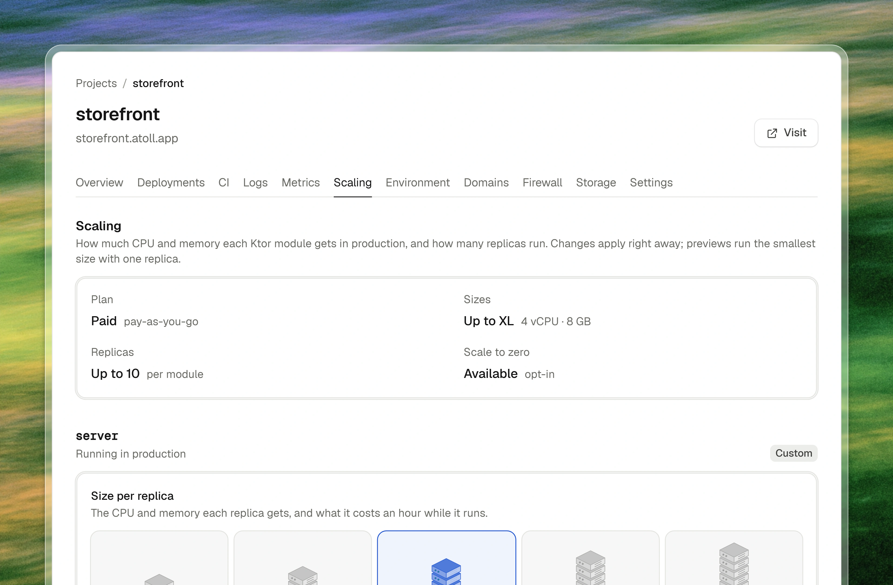

Each Ktor module of a project scales on its own in production. It has three settings:

- a **size**: the CPU and memory of one replica;
- a **minimum and a maximum** number of replicas;
- **scale to zero**: whether it stops while nobody uses it.

Scaling applies to [Ktor servers](/targets/server) only. Web apps are served by the platform itself, and Android, desktop and iOS targets are files you download.

## The Scaling tab

Open a project and click **Scaling**. The tab has three parts:

- **Scaling**, at the top, shows what your org's plan allows: **Plan**, **Sizes** (the largest size), **Replicas** (the most per module) and **Scale to zero**.
- One section per Ktor module that runs in production, such as `:server`. Its badge says **Plan default** while the module uses the plan's defaults, and **Custom** once someone saved settings for it.
- **Region** shows where the project's Ktor servers run. See [Regions](/run/regions).



A module shows up after its first production deployment. A module that has saved settings but is no longer deployed is listed as "Not running in production". Its settings apply when it is deployed again.

Every member of the org can see the scaling. Changing it needs the Developer role. See [Teams and roles](/teams/teams#roles).

## Change the scaling of a module

<Steps>
  <Step title="Open the Scaling tab">
    Open the project and click **Scaling**.
  </Step>
  <Step title="Pick the settings">
    In the module's section, pick a **Size per replica**, set **Min** and **Max** under **Replicas**, and turn **Scale to zero** on or off. The line under the settings shows what the module costs with them.
  </Step>
  <Step title="Save">
    Click **Save**. **Discard** goes back to the saved settings.
  </Step>
</Steps>

Saving applies the settings to the running app right away. You don't need to deploy. A new size starts new replicas with the new CPU and memory and stops the old ones, like a rollout.

If the running app can't be changed at that moment, the settings are still saved and the panel says so. The next deployment applies them.

<Accordion title="Change the scaling with the API">
  There is no CLI command for scaling. With a [personal access token](/account/tokens) you can read and change it over HTTP:

  ```sh
  # Read the scaling of every Ktor module
  curl -H "Authorization: Bearer $ATOLL_TOKEN" https://atoll.example.com/api/projects/my-app/scaling

  # Change one module
  curl -X PUT -H "Authorization: Bearer $ATOLL_TOKEN" -H "Content-Type: application/json" \
    -d '{"module": ":server", "settings": {"size": "s", "minReplicas": 1, "maxReplicas": 4, "scaleToZero": false}}' \
    https://atoll.example.com/api/projects/my-app/scaling
  ```

  The answer is the project's scaling after the change. Settings the plan doesn't allow are refused with the same message the panel shows.
</Accordion>

## Sizes

| Size | vCPU | Memory | Per replica-hour | One replica all month |
|------|------|--------|------------------|-----------------------|
| `xs` | 0.25 | 512 MB | 1.25¢ | \$9.13 |
| `s` | 0.5 | 1 GB | 2.5¢ | \$18.25 |
| `m` | 1 | 2 GB | 5¢ | \$36.50 |
| `l` | 2 | 4 GB | 10¢ | \$73.00 |
| `xl` | 4 | 8 GB | 20¢ | \$146.00 |

The prices follow from the CPU and memory prices on [Billing](/teams/billing#what-is-metered), for usage past the free amounts. A month is 730 hours. Each size tile on the **Scaling** tab shows the price your server charges; a server without billing shows **No charge**.

The size is also a limit: a replica can't use more CPU or memory than its size. The platform starts the JVM with `-XX:MaxRAMPercentage=75.0`, so the heap can grow to three quarters of the memory. If you set `JAVA_TOOL_OPTIONS` yourself, the platform uses yours instead.

## Replicas

The platform always runs at least **Min** replicas of the module. When the average CPU use of the replicas goes above 70% of their size, it adds replicas, up to **Max**. When the CPU use falls again, it removes them, down to **Min**.

**Min** can't be higher than **Max**. **Max** can't be higher than the plan allows; the field shows the limit, for example "Up to 3".

A new deployment keeps the number of replicas that runs at the time. Deploying doesn't reset the autoscaler.

## Scale to zero

With **Scale to zero** on, the module stops after a few minutes without requests and costs nothing while stopped. The panel shows how long: 5 minutes unless your server is set up otherwise.

- The next request to the module wakes it. That request waits until a replica runs, which takes a few seconds for a small JVM app.
- While it runs, the module scales by the requests it handles, up to **Max** replicas, at about 100 concurrent requests per replica. **Min** doesn't apply and shows "0 while idle".
- A deployment starts one replica, so the rollout shows that the new version works. The module goes back to zero once it is idle again.

<Warning>
  Requests on a [custom domain](/configure/custom-domains) don't wake a module that scaled to zero. They get an HTTP 503 until the module runs again. Keep scale to zero off for modules that people mainly reach on a custom domain.
</Warning>

Scale to zero isn't available on every server. When it isn't, the toggle is off and can't be turned on, and the tab says why, for example "Scale to zero is turned off on this server." Operators set it up as described in [Running the platform on Kubernetes](/self-hosting/kubernetes#scaling).

## Plan limits and defaults

What a module may use depends on the org's plan. The **Scaling** section at the top of the tab shows the limits that apply to you.

| | Free | Pay as you go |
|---|---|---|
| Sizes | `xs` and `s` | `xs` to `xl` |
| Replicas per module | up to 3 | up to 10 |
| Default for a module without saved settings | `xs`, 1 to 3 replicas, scale to zero on | `xs`, 1 to 3 replicas, scale to zero off |

On the free plan, larger sizes are dimmed and say **Pay-as-you-go**. To use them, an admin adds a payment method on the org's **Billing** tab. If an org goes back to the free plan, its modules are cut down to the free limits.

The free plan scales to zero by default so that idle apps don't use up the free amounts. One `xs` replica that runs all month uses about 183 vCPU-hours and 365 GB-hours, more than the 100 vCPU-hours and 200 GB-hours the free plan includes.

A self-hosted server without billing has no plan limits: the plan shows as **No limits**, and every size is allowed.

## Previews

[Previews](/deploy/previews) always run size `xs` with one replica, and never scale to zero. The settings on the **Scaling** tab apply to production only.

## What scaling costs

You pay for the size of a module times the replicas that run, counted every minute. A module that scaled to zero costs nothing. The line under each module's settings shows the range, for example:

```text
1.25¢ per replica-hour: $9.13 to $27.38 a month for 1 to 3 replicas around the clock.
```

The free amounts of the month count first. See [Billing](/teams/billing) for the free amounts and prices.

When billing stops an org's apps, for example at a [spend limit](/teams/billing#spend-limits), its Ktor servers are scaled to zero, whatever their settings. When they start again, they come back with the replicas they had. See [What happens at a limit](/teams/billing#what-happens-at-a-limit).
