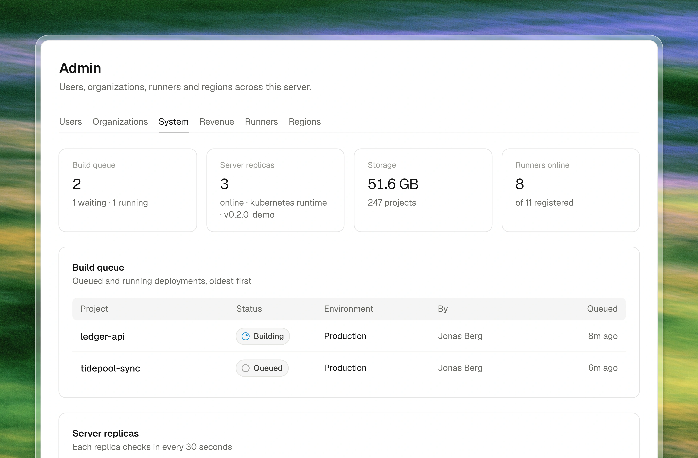

The server is configured with environment variables. This page lists every one of them with its default. With the Helm chart you set most of them through chart values instead; [Configuration](/self-hosting/configuration) maps the values to these variables.

## Server

| Variable | Default | Meaning |
|----------|---------|---------|
| `PORT` | `8080` | port the server listens on |
| `ATOLL_INTERNAL_PORT` | `8081` | with `ATOLL_RUNTIME=kubernetes`, the port build pods call back on. It serves only the build protocol (`/internal`), which `PORT` never serves; only build pods should reach it |
| `ATOLL_RUNTIME` | `local` | `kubernetes` builds in Jobs and runs apps on the cluster; anything else builds and runs on the server's own host |
| `ATOLL_ALLOW_LOCAL_BUILDS` | `false` | with a database (accounts on) the server refuses `ATOLL_RUNTIME=local`, which would run every user's code on its own host. `true` allows it anyway, for a server whose users are all trusted |
| `ATOLL_PROJECT_STORAGE_QUOTA_BYTES` | `21474836480` (20 GiB) | new deployments of a project are refused while its kept sources, web apps and artifacts take more, as measured by the last garbage collection. `0` turns the quota off |
| `ATOLL_PUBLIC_URL` | `http://localhost:<PORT>` | URL users reach the API on; links to build artifacts use it |
| `ATOLL_PANEL_URL` | `ATOLL_PUBLIC_URL` | where users open the panel; sign-in, email and checkout links lead back here. Must not be under `ATOLL_APPS_DOMAIN` |
| `ATOLL_PANEL_DIR` | unset | built panel files (`panel/dist`, from `npm run build` or `./gradlew :panel:assemble`) served on the panel URL's host; the server image sets it. Unset serves no panel |
| `ATOLL_APPS_DOMAIN` | `localhost:<PORT>` | domain of app hosts: Ktor apps on `<project>.<domain>`, web apps on `<project>-web.<domain>`; needs a wildcard DNS record |
| `ATOLL_APPS_SCHEME` | `http` | scheme of app URLs, `https` in production |
| `ATOLL_DATA_DIR` | `.atoll-data` | sources and build outputs when no bucket is set; only one server can use it |
| `ATOLL_TOKEN` | unset | bearer token that guards the API of a server without accounts (no database). Ignored once accounts are on. Unset: no authentication, for local development only |

## Accounts

Accounts are on when the server has a database. People sign up in the panel, work in orgs, and the CLI signs in with `atoll login` or a personal access token.

| Variable | Default | Meaning |
|----------|---------|---------|
| `ATOLL_AUTH_SMTP_HOST` | unset | SMTP server for verification, password reset and invite emails. Unset: the links are logged while the panel is on http; with an https panel no email is sent, so set it |
| `ATOLL_AUTH_SMTP_PORT` | `587` | SMTP port; `465` uses implicit TLS |
| `ATOLL_AUTH_SMTP_USER` | unset | SMTP user name |
| `ATOLL_AUTH_SMTP_PASSWORD` | unset | SMTP password |
| `ATOLL_AUTH_SMTP_FROM` | none, required with a host | sender, e.g. `Example <no-reply@example.com>` |
| `ATOLL_AUTH_SMTP_STARTTLS` | `true` | use STARTTLS on ports other than 465 |
| `ATOLL_AUTH_GITHUB_CLIENT_ID` | unset | GitHub OAuth app; with the secret, enables the GitHub sign-in button. Callback: `<panel>/api/auth/oauth/github/callback` |
| `ATOLL_AUTH_GITHUB_CLIENT_SECRET` | unset | secret of that OAuth app; set both or neither |
| `ATOLL_AUTH_GOOGLE_CLIENT_ID` | unset | Google OAuth client; with the secret, enables the Google sign-in button. Callback: `<panel>/api/auth/oauth/google/callback` |
| `ATOLL_AUTH_GOOGLE_CLIENT_SECRET` | unset | secret of that client; set both or neither |
| `ATOLL_AUTH_ADMIN_EMAILS` | unset | comma-separated platform admins; once their email is verified they act as owner of every org and see the admin area. More admins can be made in the panel; the ones listed here can only be removed here |
| `ATOLL_AUTH_TRUST_FORWARDED` | `false` | `true` behind a proxy, so rate limits and audit see the client's address from `X-Forwarded-For` and the scheme from `X-Forwarded-Proto` |

## Admin area

Platform admins (see `ATOLL_AUTH_ADMIN_EMAILS`) get an Admin page in the panel: users and orgs (search, suspend, delete, make admin), system status (build queue, replicas, runners, storage), revenue, and "view as user". It needs accounts, so a server without a database has none.

- A suspended user can't sign in; their sessions end and their tokens stop working until they are unsuspended.
- A suspended org has its apps scaled to zero, like billing does past a limit, until it is unsuspended.
- "View as user" turns the admin's own session into a read-only view of the panel as that user: the server refuses every change in it, and the panel shows a banner with "Stop viewing". It only applies to the panel's requests; a link opened in the browser still acts as the admin.
- Every admin action and every view as a user is written to an audit log, shown on the System tab.

| Variable | Default | Meaning |
|----------|---------|---------|
| `ATOLL_ADMIN_VIEW_AS_MINUTES` | `60` | how long a "view as user" session lasts before it ends by itself, 1-1440 |

## Env vars

| Variable | Default | Meaning |
|----------|---------|---------|
| `ATOLL_ENV_KEYS` | unset; required with a database | comma-separated `id:base64key` AES-256 keys that encrypt env var values, e.g. `k1:$(openssl rand -base64 32)`. The first key encrypts; see [encryption keys](/reference/env#self-hosting-encryption-keys) for rotation |

## Build runners

| Variable | Default | Meaning |
|----------|---------|---------|
| `ATOLL_RUNNERS_SEAL_KEY` | unset; required with a database | base64 AES-256 key (`openssl rand -base64 32`) that encrypts a runner job's build env vars while it waits and runs. Set the same key on every replica; the server doesn't start with a database and no key |
| `ATOLL_RUNNERS_QUEUE_TIMEOUT_MINUTES` | `15` | a runner job no runner picks up in this time is skipped, with a note on the target |
| `ATOLL_RUNNERS_JOB_TIMEOUT_MINUTES` | `60` | a runner job running longer fails |
| `ATOLL_RUNNERS_SHARED_FALLBACK_SECONDS` | `120` | how long a job of an org with its own runner of that OS online waits for one of them before shared runners may take it; `0` lets them take it at once |

See [Build runners](/self-hosting/runners).

## Email notifications

Users get emails about failed, partial, recovered and live deployments, spend limits and their org's runners; each user picks which on the Account page and per project in its settings (see [Notifications](/teams/notifications)). They need accounts, so a server without a database sends none. Emails go through the SMTP server of `ATOLL_AUTH_SMTP_*`; without one they are written to the server log. Only verified addresses get them, and every email has an unsubscribe link and a one-click `List-Unsubscribe` header.

- Sending never holds up a deployment: emails are queued, retried a few times when SMTP fails, and sent once per deployment, event and user, also with several replicas.
- After an email to someone, more within the digest window are held and sent as one digest.

| Variable | Default | Meaning |
|----------|---------|---------|
| `ATOLL_NOTIFICATIONS_ENABLED` | `true` | `false` sends no notification emails; the panel says they are off |
| `ATOLL_NOTIFICATIONS_DIGEST_SECONDS` | `60` | after an email to a user, further ones within this many seconds come as one digest, 0-3600. `0` sends each at once |

## Regions

| Variable | Default | Meaning |
|----------|---------|---------|
| `ATOLL_REGIONS_SEAL_KEY` | unset | base64 AES-256 key (`openssl rand -base64 32`) that encrypts the kubeconfigs of regions. Set the same key on every replica. Unset: the server runs everything in its own cluster and refuses to add regions with credentials (without a database a key for the process is used) |
| `ATOLL_REGIONS_HOME_ID` | `home` | id of the built-in region the server runs in; set it before the first start |
| `ATOLL_REGIONS_HOME_NAME` | `Home` | name the home region gets when it is first added; admins can rename it later |
| `ATOLL_REGIONS_HOME_COUNTRY` | unset | country (ISO 3166-1 code such as `de`, or `eu`) the home region gets when it is first added; admins can change it later |

See [Regions](/self-hosting/kubernetes#regions).

## App metrics

| Variable | Default | Meaning |
|----------|---------|---------|
| `ATOLL_METRICS_PROMETHEUS_URL` | unset | Prometheus the Metrics tab reads; a region's own Prometheus URL wins. Unset: `ATOLL_BILLING_PROMETHEUS_URL`; neither: the tab says metrics aren't available |

See [App metrics](/self-hosting/monitoring).

## Data stores

Postgres, Redis and Files stores users create in the panel. They need `ATOLL_RUNTIME=kubernetes`.

| Variable | Default | Meaning |
|----------|---------|---------|
| `ATOLL_DATASTORE_ENABLED` | `true` | `false` turns Storage off; the panel says so |
| `ATOLL_DATASTORE_FAKE` | `false` | `true` runs every kind with a fake engine that creates nothing, for development without Kubernetes |
| `ATOLL_DATASTORE_MAX_PER_ORG` | `10` | stores one org may have |
| `ATOLL_DATASTORE_NAMESPACE` | `atoll-storage` | namespace of the stores in every region's cluster |
| `ATOLL_DATASTORE_SERVER_NAMESPACE` | the server's namespace, else `atoll` | where atoll-server runs; store NetworkPolicies admit it |
| `ATOLL_DATASTORE_RECONCILE_SECONDS` | `15` | how often stores being created, resized, restored or deleted are checked |
| `ATOLL_DATASTORE_STORAGE_CLASS` | cluster default | StorageClass of store disks; resizing needs one that allows volume expansion |
| `ATOLL_DATASTORE_POSTGRES_IMAGE` | `ghcr.io/cloudnative-pg/postgresql:18-standard-trixie` | Postgres image of new stores |
| `ATOLL_DATASTORE_BACKUP_ENDPOINT` | unset | S3 endpoint of Postgres backups (WAL archive and daily base backups). Unset: Postgres stores have no backups |
| `ATOLL_DATASTORE_BACKUP_BUCKET` | `atoll-store-backups` | bucket of Postgres backups |
| `ATOLL_DATASTORE_BACKUP_SECRET` | `atoll-store-backups` | Secret in the storage namespace with the backup keys `ACCESS_KEY_ID` and `ACCESS_SECRET_KEY` |
| `ATOLL_DATASTORE_BACKUP_REGION` | `us-east-1` | S3 region of the backup endpoint |
| `ATOLL_DATASTORE_REDIS_IMAGE` | `valkey/valkey:9.1.3-alpine` | Redis-compatible image of new stores |
| `ATOLL_DATASTORE_REDIS_STORAGE_CLASS` | `ATOLL_DATASTORE_STORAGE_CLASS` | StorageClass of Redis disks |
| `ATOLL_DATASTORE_FILES_ENDPOINT` | `http://atoll-files-s3.<namespace>.svc:8333` | S3 endpoint of Files stores inside the cluster |
| `ATOLL_DATASTORE_FILES_PUBLIC_ENDPOINT` | `https://s3.<ATOLL_APPS_DOMAIN>` | public S3 endpoint apps and browsers use |
| `ATOLL_DATASTORE_FILES_REGION` | `us-east-1` | S3 region of Files stores |
| `ATOLL_DATASTORE_FILES_ACCESS_KEY` | unset | S3 admin key of the Files SeaweedFS; set both or neither. Unset: read from the Secret `atoll-files-s3-config` |
| `ATOLL_DATASTORE_FILES_SECRET_KEY` | unset | secret of that key |

See [Storage](/self-hosting/storage).

## Firewall

| Variable | Default | Meaning |
|----------|---------|---------|
| `ATOLL_FIREWALL_EDGE` | `false` | `true` when atoll-edge filters traffic (the Helm chart sets it); `false` runs the firewall inside the server, for web apps only |
| `ATOLL_FIREWALL_CHALLENGE_KEY` | a random key per process | signs challenge pages and the `__atoll_fw` cookie, at least 16 characters. Set the same key on every server and edge replica |
| `ATOLL_FIREWALL_CHALLENGE_DIFFICULTY` | `16` | proof-of-work bits a challenge page solves, 1-24 |
| `ATOLL_FIREWALL_ALERT_THRESHOLD` | `100000` | mitigated requests of a project within 10 minutes that raise an alert |
| `ATOLL_FIREWALL_MAX_RULES` | `40` | custom rules (and rate limit rules) per project on pay-as-you-go, or with billing off |
| `ATOLL_FIREWALL_MAX_IP_BLOCKS` | `100` | IP blocks per project on pay-as-you-go |
| `ATOLL_FIREWALL_MIN_WINDOW_SECONDS` | `10` | shortest rate limit window |
| `ATOLL_FIREWALL_MAX_WINDOW_SECONDS` | `3600` | longest rate limit window on pay-as-you-go |
| `ATOLL_FIREWALL_FREE_RULES` | `3` | custom rules per project on the free plan |
| `ATOLL_FIREWALL_FREE_RATE_LIMIT_RULES` | `1` | rate limit rules per project on the free plan |
| `ATOLL_FIREWALL_FREE_IP_BLOCKS` | `10` | IP blocks per project on the free plan |
| `ATOLL_FIREWALL_FREE_MAX_WINDOW_SECONDS` | `600` | longest rate limit window on the free plan |
| `ATOLL_FIREWALL_NAMESPACE` | `atoll-firewall` | namespace of atoll-edge and the per-project firewall ConfigMaps |

The Helm chart sets these on atoll-edge (the server image started with `ATOLL_ROLE=edge`):

| Variable | Default | Meaning |
|----------|---------|---------|
| `ATOLL_ROLE` | – | `edge` starts atoll-edge instead of the API server |
| `ATOLL_FIREWALL_APPS_DOMAIN` | `ATOLL_APPS_DOMAIN` | apps domain, to find the project of a web app host and tell previews from production |
| `ATOLL_FIREWALL_EDGE_PORT` | `8090` | port of the edge |
| `ATOLL_FIREWALL_VALKEY_URL` | – | Valkey for rate limit counters and persistent blocks; without it each edge replica counts alone |
| `ATOLL_FIREWALL_CACHE_DIR` | `$TMPDIR/atoll-edge` | writable directory for the geo databases and good-bot lists |
| `ATOLL_FIREWALL_POD_NAME` | `HOSTNAME` | name the edge reports its traffic under |
| `ATOLL_FIREWALL_WAF_URL` | – | the OWASP sidecar, e.g. `http://127.0.0.1:8091`; without it OWASP rules never match |
| `ATOLL_FIREWALL_WAF_TIMEOUT_MS` | `50` | time budget of one OWASP inspection; slower ones let the request through |

See [Firewall](/configure/firewall).

## Database, storage, Kubernetes, domains and billing

These settings are documented next to what they configure:

- [Running the platform on Kubernetes](/self-hosting/kubernetes#configuration): database, object storage, builds, the Kubernetes runtime
  and app scaling (`ATOLL_SCALING_*`: scale to zero, idle time, replica caps)
- [Custom domains](/reference/domains#running-your-own-server): DNS checks, certificates and domain Ingresses
- [Billing settings](/self-hosting/billing-settings): Stripe, prices and free amounts

### Running the platform on Kubernetes

From [Running the platform on Kubernetes](/self-hosting/kubernetes).

| Variable | Default | Meaning |
|----------|---------|---------|
| `ATOLL_DATABASE_URL` | unset; required in Kubernetes mode | JDBC URL of the platform's Postgres, e.g. `jdbc:postgresql://atoll-postgres.atoll.svc.cluster.local:5432/atoll`. With it, accounts are on |
| `ATOLL_DATABASE_USER` | unset | database user |
| `ATOLL_DATABASE_PASSWORD` | unset | database password |
| `ATOLL_DATABASE_WAIT_SECONDS` | `120` | how long startup waits for Postgres before giving up |
| `ATOLL_STORAGE_BUCKET` | unset | bucket for sources, web apps and artifacts; created if missing. Unset keeps files in `ATOLL_DATA_DIR`, which allows only one replica |
| `ATOLL_STORAGE_ENDPOINT` | unset | S3 endpoint, e.g. `http://atoll-storage.atoll.svc.cluster.local:8333`; unset means AWS S3 |
| `ATOLL_STORAGE_REGION` | `us-east-1` | bucket region (`auto` for Cloudflare R2) |
| `ATOLL_STORAGE_ACCESS_KEY` / `ATOLL_STORAGE_SECRET_KEY` | unset | keys; without them the AWS default credentials chain is used |
| `ATOLL_STORAGE_PATH_STYLE` | `true` when an endpoint is set | `bucket` in the path instead of the host name |
| `ATOLL_STORAGE_WAIT_SECONDS` | `120` | how long startup waits for the storage endpoint to accept connections before giving up |
| `ATOLL_INTERNAL_URL` | `http://atoll-server.atoll.svc.cluster.local:<ATOLL_INTERNAL_PORT>` | how build pods reach the server's internal port |
| `ATOLL_BUILD_NAMESPACE` | `atoll-builds` | namespace for build Jobs |
| `ATOLL_APPS_NAMESPACE` | `atoll-apps` | namespace for Ktor apps |
| `ATOLL_BUILDER_IMAGE` | `atoll/builder:latest` | image of the build pods; the chart uses the release image of its version |
| `ATOLL_REGISTRY_PUSH` | required | registry build pods push app images to |
| `ATOLL_REGISTRY_PULL` | the push value | the same registry as nodes reach it, for image references in app Deployments |
| `ATOLL_REGISTRY_INSECURE` | `false` | push over plain HTTP (only an in-cluster test registry) |
| `ATOLL_REGISTRY_PUSH_SECRET` | unset | `kubernetes.io/dockerconfigjson` Secret in the builds namespace, mounted read-only into the `publish` container only. Its `auths` key is the push host |
| `ATOLL_REGISTRY_PULL_SECRET` | unset | dockerconfigjson Secret in the apps namespace, the `imagePullSecrets` of app pods. Its `auths` key is the pull host |
| `ATOLL_BUILDER_PULL_SECRET` | unset | dockerconfigjson Secret in the builds namespace for a private builder image |
| `ATOLL_BUILD_RUNTIME_CLASS` | unset | RuntimeClass for build pods, e.g. `gvisor` |
| `ATOLL_BUILD_NODE_SELECTOR` | unset | JSON object of node labels for build pods, e.g. `{"atoll.app/pool":"builds"}` |
| `ATOLL_BUILD_TOLERATIONS` | unset | JSON array of tolerations for build pods, e.g. `[{"key":"atoll.app/builds","operator":"Exists","effect":"NoSchedule"}]` |
| `ATOLL_INGRESS_CLASS` | `nginx` | `ingressClassName` of app Ingresses; the chart sets its `ingress.className` (`traefik`) |
| `ATOLL_BUILD_TIMEOUT` | `1800` | seconds before a build is killed |
| `ATOLL_BUILD_CPU` / `ATOLL_BUILD_MEMORY` | `2` / `6Gi` | requests and limits of a build pod |
| `ATOLL_MAX_BUILDS` | `2` | builds at once **per replica** |
| `ATOLL_BUILD_MAX_OUTPUT_BYTES` | `2147483648` (2 GiB) | bytes of web apps (unpacked) and artifacts one build may upload |
| `ATOLL_BUILD_MAX_FILE_BYTES` | `1073741824` (1 GiB) | bytes of one artifact or one file of a web app |
| `ATOLL_BUILD_MAX_SITE_FILES` | `20000` | files, directories and links in one web app |
| `ATOLL_SCALING_SCALE_TO_ZERO` | `keda` | `keda` lets modules scale to zero through the KEDA HTTP add-on wherever the cluster has its `HTTPScaledObject` API; `off` never does |
| `ATOLL_SCALING_INTERCEPTOR` | `keda-add-ons-http-interceptor-proxy.keda.svc.cluster.local:8080` | `host:port` of the add-on's interceptor proxy Service |
| `ATOLL_SCALING_IDLE_MINUTES` | `5` | minutes without requests before a module scales to zero |
| `ATOLL_SCALING_MAX_REPLICAS` | `10` | the most replicas any module may run |
| `ATOLL_SCALING_FREE_MAX_REPLICAS` | `3` | the most replicas a module of a free org may run |

### Custom domains

From [Custom domains](/reference/domains).

| Variable | Default | Meaning |
|----------|---------|---------|
| `ATOLL_DOMAINS_CNAME_TARGET` | `cname.<ATOLL_APPS_DOMAIN>` | host subdomains CNAME to; must resolve to your ingress controller (the wildcard record of the apps domain covers the default) |
| `ATOLL_DOMAINS_A_RECORDS` | empty | comma-separated IPv4/IPv6 addresses of the ingress for apex domains; empty asks for ALIAS records instead |
| `ATOLL_DOMAINS_RESOLVERS` | `1.1.1.1,8.8.8.8,9.9.9.9` | DNS servers used for verification, `host` or `host:port` |
| `ATOLL_DOMAINS_CLUSTER_ISSUER` | `letsencrypt` | cert-manager ClusterIssuer for domain certificates |
| `ATOLL_DOMAINS_CHECK_INTERVAL` | `60` | seconds between checks of pending domains and certificates |
| `ATOLL_DOMAINS_RECHECK_INTERVAL` | `86400` | seconds between checks of verified domains |
| `ATOLL_DOMAINS_MAX_PER_PROJECT` | `50` | domains per project |
| `ATOLL_DOMAINS_UNVERIFIED_DAYS` | `7` | days before an unverified domain is removed |
| `ATOLL_DOMAINS_TXT_GRACE_DAYS` | `7` | days an owner's TXT record may be missing before the domain is released |
| `ATOLL_DOMAINS_NAMESPACE` | `atoll-domains` | namespace of domain Ingresses, TLS secrets and Services in Kubernetes |
| `ATOLL_DOMAINS_SERVER_SERVICE` | `atoll-server` | Service in that namespace that leads to atoll-server |
| `ATOLL_DOMAINS_SERVER_PORT` | `8080` | port of that Service |
| `ATOLL_DOMAINS_CLUSTER_DOMAIN` | `cluster.local` | cluster DNS suffix used to reach apps from that namespace |
| `ATOLL_DOMAINS_INGRESS_ANNOTATIONS` | empty | extra Ingress annotations, comma-separated `key=value` |

### Billing settings

From [Billing settings](/self-hosting/billing-settings).

| Variable | Default | Meaning |
|----------|---------|---------|
| `ATOLL_BILLING_STRIPE_SECRET_KEY` | unset | Stripe secret key (`sk_live_...` or `sk_test_...`). Turns billing on. |
| `ATOLL_BILLING_STRIPE_WEBHOOK_SECRET` | unset | Signing secret of the webhook endpoint (`whsec_...`). Required with the key. |
| `ATOLL_BILLING_STRIPE_API_URL` | `https://api.stripe.com` | Only for proxies or a Stripe mock. |
| `ATOLL_BILLING_PAYMENT_GRACE_DAYS` | `7` | Days a failed invoice may stay unpaid before new deployments are refused. |
| `ATOLL_BILLING_PROMETHEUS_URL` | unset | Prometheus that scrapes the ingress controller; used for Ktor app bandwidth. Unset: not counted. |
| `ATOLL_BILLING_INGRESS` | `traefik` | Which controller's metrics to read: `traefik` (`traefik_service_responses_bytes_total`) or `nginx` (`nginx_ingress_controller_response_size_sum`). |
| `ATOLL_BILLING_FREE_<METRIC>` | per metric | Free allowance per org per calendar month (UTC), in the metric's unit. `0` means no free usage. `<METRIC>` is `BUILD_MINUTES`, `CPU_HOURS`, `MEMORY_GB_HOURS`, `BANDWIDTH_GB`, `STORAGE_GB_MONTHS`, `BUILD_MINUTES_WINDOWS` or `BUILD_MINUTES_MACOS`. |
| `ATOLL_BILLING_PRICE_<METRIC>` | per metric | Price in US dollars per unit past the allowance, e.g. `0.04`. |

### Deploy from GitHub

From [Deploy from GitHub](/deploy/git).

| Variable | Value |
|----------|-------|
| `ATOLL_GIT_GITHUB_APP_ID` | the app's App ID |
| `ATOLL_GIT_GITHUB_APP_SLUG` | the app's URL name, from `https://github.com/apps/<slug>` |
| `ATOLL_GIT_GITHUB_PRIVATE_KEY` | the `.pem` contents (`\n` escapes are accepted) |
| `ATOLL_GIT_GITHUB_PRIVATE_KEY_FILE` | or a path to the `.pem` file |
| `ATOLL_GIT_GITHUB_WEBHOOK_SECRET` | the webhook secret |
| `ATOLL_GIT_GITHUB_CLIENT_ID` | the app's Client ID |
| `ATOLL_GIT_GITHUB_CLIENT_SECRET` | the client secret |
| `ATOLL_GIT_GITHUB_API_URL` | optional, default `https://api.github.com`; `https://<host>/api/v3` for GitHub Enterprise Server |
| `ATOLL_GIT_GITHUB_WEB_URL` | optional, default `https://github.com`, or the Enterprise host when the API URL ends in `/api/v3` |

### CI

From [CI](/deploy/ci).

| Variable | Default | Meaning |
|----------|---------|---------|
| `ATOLL_CI_TIMEOUT_MINUTES` | `30` | a run that takes longer is stopped and ends as `ERROR` |
| `ATOLL_CI_MAX_CONCURRENT` | `2` | runs at once per server; more wait as queued. Separate from the build slots of deployments |

### App distribution

From [App distribution](/deploy/distribution).

| Variable | Default | |
|----------|---------|---|
| `ATOLL_DISTRIBUTION_GRANT_MINUTES` | `30` | How long a password unlocks downloads |
| `ATOLL_DISTRIBUTION_MAX_LINKS` | `20` | Active links per deployment |
| `ATOLL_AUTH_TRUST_FORWARDED` | `false` | Shared with sign-in: take the client address for rate limits from `X-Forwarded-For` |
| `ATOLL_PANEL_URL` | public URL | Where links point |

## Not server settings

- The server passes `ATOLL_SERVER`, `ATOLL_DEPLOYMENT_ID`, `ATOLL_PROJECT`, `ATOLL_BUILD_TOKEN` (a different one to each of the pod's two containers), `ATOLL_IMAGE_REPO`, `ATOLL_WORK_DIR`, `ATOLL_OUT_DIR`, `ATOLL_ENV_DIR` and `ATOLL_RUNNERS` to build pods. Don't set them yourself.
- On users' machines, the CLI reads `ATOLL_SERVER` and `ATOLL_TOKEN`; see the [CLI reference](/reference/cli).
- On runner hosts, `atoll-runner` reads `ATOLL_SERVER`, `ATOLL_REGISTRATION_TOKEN`, `ATOLL_RUNNER_TOKEN_FILE` and `ATOLL_JOB_TOKEN`; see [Build runners](/self-hosting/runners).
- Projects can't use env vars named `PORT` or starting with `ATOLL_`; the platform drops them at deploy time.
