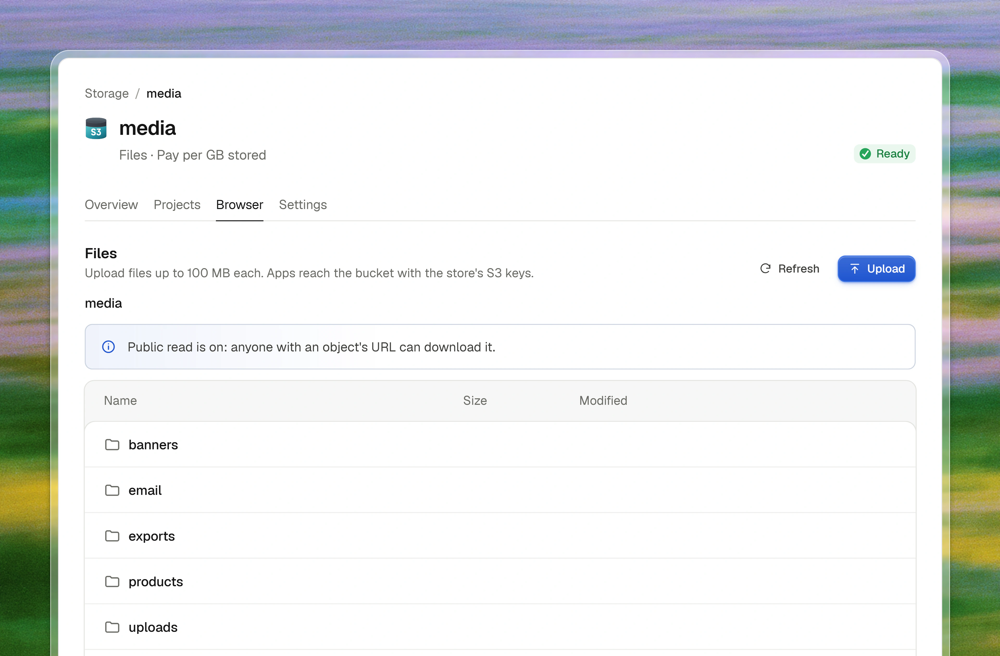

A Files store is one S3 bucket. Your apps read and write it with an S3 client and the store's keys. It has no fixed size: you pay for what it holds. Create the store on the **Storage** page and connect it to your project as described in [Storage](/storage/overview).

## Env vars

A connected project gets these runtime env vars, with the connection's prefix in front if it has one:

| Name | Value |
|------|-------|
| `S3_ENDPOINT` | The endpoint inside the platform, for your apps, for example `http://atoll-files-s3.atoll-storage.svc:8333` |
| `S3_PUBLIC_ENDPOINT` | The endpoint from anywhere, `https://s3.<apps domain>` |
| `S3_BUCKET` | The bucket's name, `st-<id>` |
| `S3_REGION` | The region to sign requests with, `us-east-1` |
| `AWS_ACCESS_KEY_ID` | The store's access key |
| `AWS_SECRET_ACCESS_KEY` | The store's secret key |

Use `S3_ENDPOINT` from your apps. Use `S3_PUBLIC_ENDPOINT` for anything outside the platform: your own machine, CI, and presigned URLs you hand to browsers.

The keys only work for this bucket. They can list, read, write and delete its objects, including multipart uploads and object tags.

## Client settings

Set these in any S3 client you point at a Files store:

- **Path-style addressing**: the bucket goes in the path, as in `https://s3.<apps domain>/st-<id>/<key>`, not in the host name.
- **Checksums only when required**: the store rejects the checksum trailers that recent AWS SDKs send by default.

## Connect from Ktor

This example uses the AWS SDK for Java (`software.amazon.awssdk:s3`) in your server module:

```kotlin
import java.net.URI
import software.amazon.awssdk.auth.credentials.AwsBasicCredentials
import software.amazon.awssdk.auth.credentials.StaticCredentialsProvider
import software.amazon.awssdk.core.checksums.RequestChecksumCalculation
import software.amazon.awssdk.core.checksums.ResponseChecksumValidation
import software.amazon.awssdk.core.sync.RequestBody
import software.amazon.awssdk.regions.Region
import software.amazon.awssdk.services.s3.S3Client

val bucket: String = System.getenv("S3_BUCKET")
val region: Region = Region.of(System.getenv("S3_REGION"))
val credentials: StaticCredentialsProvider = StaticCredentialsProvider.create(
    AwsBasicCredentials.create(System.getenv("AWS_ACCESS_KEY_ID"), System.getenv("AWS_SECRET_ACCESS_KEY")),
)

val s3: S3Client = S3Client.builder()
    .endpointOverride(URI.create(System.getenv("S3_ENDPOINT")))
    .region(region)
    .credentialsProvider(credentials)
    .forcePathStyle(true)
    .requestChecksumCalculation(RequestChecksumCalculation.WHEN_REQUIRED)
    .responseChecksumValidation(ResponseChecksumValidation.WHEN_REQUIRED)
    .build()

fun saveAvatar(userId: Long, png: ByteArray) {
    s3.putObject({ it.bucket(bucket).key("avatars/$userId.png").contentType("image/png") }, RequestBody.fromBytes(png))
}
```

To let a browser download a private object, sign a URL against the public endpoint:

```kotlin
import java.time.Duration
import software.amazon.awssdk.services.s3.S3Configuration
import software.amazon.awssdk.services.s3.presigner.S3Presigner

val presigner: S3Presigner = S3Presigner.builder()
    .endpointOverride(URI.create(System.getenv("S3_PUBLIC_ENDPOINT")))
    .region(region)
    .credentialsProvider(credentials)
    .serviceConfiguration(S3Configuration.builder().pathStyleAccessEnabled(true).build())
    .build()

fun avatarUrl(userId: Long): String =
    presigner.presignGetObject { request ->
        request.signatureDuration(Duration.ofMinutes(15))
            .getObjectRequest { it.bucket(bucket).key("avatars/$userId.png") }
    }.url().toString()
```

If you connected the store with a prefix, read the prefixed names, for example `MEDIA_S3_BUCKET`.

## Browse files in the panel



The store's **Browser** tab lists the bucket's files. Folders are the parts of the keys between `/`. Click a folder to open it, and use the path above the list to go back up. The list shows 200 entries at a time; click **Load more** for the rest, and **Refresh** to reload it.

- **Download**: the download button next to a file saves it.
- **Upload**: click **Upload** and pick one or more files. They go into the folder you have open. A file with the same name replaces the one in the bucket.
- **Delete**: the delete button next to a file removes it from the bucket for good. Files stores keep no older versions.

The panel uploads files up to 100 MB each. For larger files, use an S3 client with the store's keys and `S3_PUBLIC_ENDPOINT`.

Browsing and downloading need the Viewer role. Uploading and deleting need the Developer role.

## Public read

By default every request to the bucket has to be signed with its keys or come with a presigned URL. To serve files to anyone, an admin turns on **Public read** in the **Access** section of the store's **Settings** tab.

With public read on:

- Anyone with an object's URL can download it without signing. The URL is `S3_PUBLIC_ENDPOINT/S3_BUCKET/` followed by the key, for example `https://s3.<apps domain>/st-<id>/avatars/42.png`.
- Nobody can list the bucket without its keys.
- Uploads and deletes still need the keys.
- In the **Browser** tab, developers get a button next to each file that copies its public URL.

<Warning>
  With public read on, anyone who knows or guesses a key can download that file. Keep private files in a store with public read off.
</Warning>

Turn **Public read** off again to require signed requests. The store must be **Ready** to change it.

## Size and billing

A Files store has no size to pick and can't be resized. It is billed for what the bucket holds, measured every hour, on the **Storage** meter. See [Billing](/storage/overview#billing).

On the free plan, a Files store includes up to 1 GB. The store's **Overview** tab shows how much of it is used, and the panel refuses uploads past it.

Deleting the store deletes every file in it.
