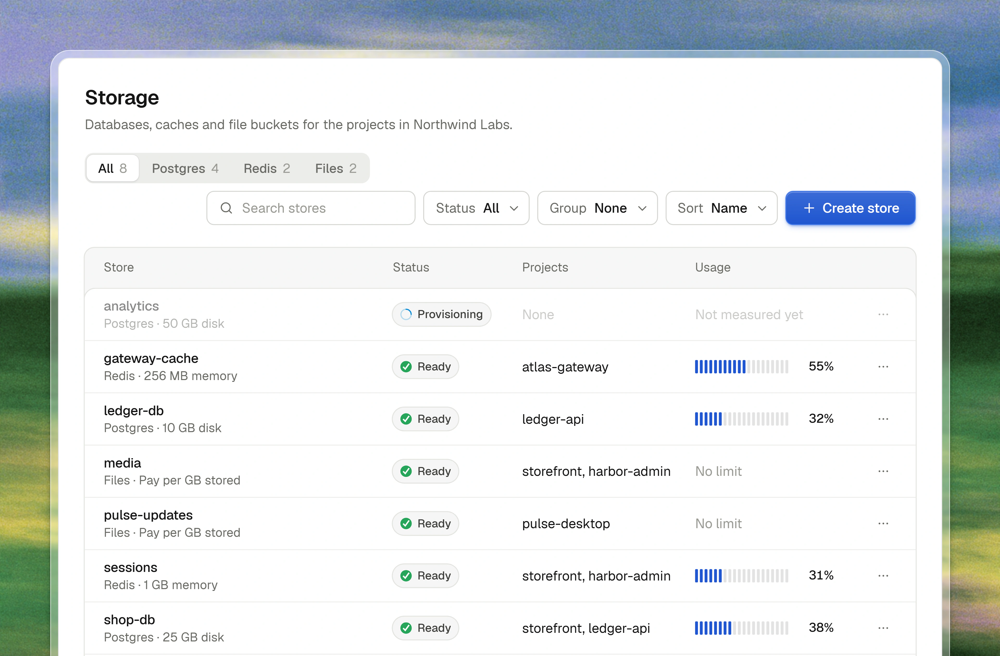

A store is a database, a cache or a file bucket that the platform runs for your org. You create it once in the panel and connect it to one or more projects. Connected projects get its connection details as env vars, so your Ktor servers can use it without any setup of their own.

## Kinds of stores

<CardGroup cols={3}>
  <Card title="Postgres" icon="database" href="/storage/postgres">
    A Postgres database with daily backups and restore to any moment of the last 7 days.
  </Card>
  <Card title="Redis" icon="bolt" href="/storage/redis">
    A Redis-compatible cache and queue (Valkey), kept on disk.
  </Card>
  <Card title="Files" icon="folder-open" href="/storage/files">
    An S3-compatible bucket for uploads and assets, billed by what it holds.
  </Card>
</CardGroup>

| Kind | Sizes |
|------|-------|
| Postgres | 1, 5, 10, 25, 50 or 100 GB disk |
| Redis | 256 MB, 1 GB or 4 GB memory |
| Files | No fixed size |

A store belongs to an org and runs in one region. Projects of the same org and region can connect to it. Postgres and Redis stores only accept connections from the apps of the projects connected to them. A Files bucket is guarded by its keys, which only connected projects get.

## Find your stores

In the panel, click **Storage** in the sidebar. The page lists the org's stores with their type, status, region, connected projects and how full they are. Use the tabs above the list to show one kind, or search, filter by **Status**, **Group** and **Sort** the list.

Click a store to open its page. It has these tabs:

| Tab | What it shows |
|-----|---------------|
| **Overview** | Usage, details and the connection values |
| **Projects** | The connected projects, their environments and prefixes |
| **Backups** | Postgres only: backups and restore, see [Postgres](/storage/postgres#backups) |
| **Browser** | Files only: the bucket's files, see [Files](/storage/files#browse-files-in-the-panel) |
| **Settings** | Resize, credentials, public read (Files) and delete |

## Create a store

<Steps>
  <Step title="Open the dialog">
    On the **Storage** page, click **Create store**.
  </Step>
  <Step title="Pick a kind">
    Choose **Postgres**, **Redis** or **Files**.
  </Step>
  <Step title="Name it">
    Use 3 to 40 lowercase letters, digits or `-`. The name must be unique in the org.
  </Step>
  <Step title="Pick a region">
    The **Region** field only shows when there is more than one region. Otherwise the store goes to the default region. Only projects in the same region can connect to the store.
  </Step>
  <Step title="Pick a size">
    For Postgres and Redis, choose the **Size**. Files has no size.
  </Step>
  <Step title="Create it">
    Click **Create store**. The store's page opens. It shows **Provisioning** until the store is ready.
  </Step>
</Steps>

You can't change a store's kind, name or region later. Its size can only grow.

## Connect a store to a project

You can start from either side:

- From the store: open its **Projects** tab and click **Connect project**.
- From the project: open the project's **Storage** tab and click **Connect store**.

In the dialog, pick the project or the store. Only those in the same region are offered. Then set:

- **Environments**: **Production**, **Preview** or both. Both are ticked by default.
- **Env var prefix (optional)**: a prefix for every env var name, for example `ANALYTICS_` turns `DATABASE_URL` into `ANALYTICS_DATABASE_URL`.

Click **Connect**. Postgres and Redis stores accept connections from the project's apps right away. The env vars reach the apps on their next deploy. To apply them now, [redeploy](/deploy/deployments) the project.

### How the env vars reach your apps

- They are runtime env vars: your [Ktor servers](/targets/server) get them when they start. Builds don't get them.
- They are always secret.
- They apply on the next deployment of each connected environment.
- If the project already sets a variable with the same name, the project's own value wins. The panel shows a warning on the store's **Projects** tab and on the project's **Storage** tab.
- Two stores can't give a project the same env var in the same environment. To connect a second Postgres store to a project, give one of the two connections a prefix.

Each kind sets its own variables:

| Kind | Env vars |
|------|----------|
| Postgres | `DATABASE_URL`, `JDBC_DATABASE_URL`, `PGHOST`, `PGPORT`, `PGDATABASE`, `PGUSER`, `PGPASSWORD` |
| Redis | `REDIS_URL`, `REDIS_HOST`, `REDIS_PORT`, `REDIS_PASSWORD` |
| Files | `S3_ENDPOINT`, `S3_PUBLIC_ENDPOINT`, `S3_BUCKET`, `S3_REGION`, `AWS_ACCESS_KEY_ID`, `AWS_SECRET_ACCESS_KEY` |

The store's **Overview** tab lists the names under **Connection**. Members with the Developer role can click **Reveal values** to see and copy them, and to get them as a `.env` block.

### Prefixes

A prefix is up to 32 uppercase letters, digits or `_`, and starts with a letter. It can't start with `ATOLL`. The platform puts it in front of each name as it is, so end it with `_`: `CACHE_` gives `CACHE_REDIS_URL`, `CACHE` gives `CACHEREDIS_URL`.

### Previews

<Tip>
  Previews connected to a store use the same data as production. To keep them apart, create a second store. Connect the first one with only **Production** and the second one with only **Preview**.
</Tip>

### Change or disconnect

On the store's **Projects** tab, click **Change** next to a project to pick other environments or another prefix. Click **Disconnect** to remove the connection.

After you disconnect a project, a Postgres or Redis store no longer accepts new connections from its apps. The apps lose the env vars on their next deploy. The store and its data stay.

## Store status

| Status | Meaning |
|--------|---------|
| **Provisioning** | The store is being created. Connections work once it is ready. |
| **Ready** | The store is running. |
| **Resizing** | The store is growing to a new size. It keeps running meanwhile. |
| **Restoring** | A Postgres store is being restored. Its connection stays the same. |
| **Failed** | Something went wrong. The **Overview** tab says why. |
| **Deleting** | The store is being deleted. |

The usage on the **Overview** tab is measured about once an hour.

## Resize a store

Postgres and Redis stores can grow. Files stores have no size to change.

<Steps>
  <Step title="Open the settings">
    Open the store's **Settings** tab. The **Capacity** section shows the current size.
  </Step>
  <Step title="Pick a new size">
    Click **Resize** and pick a larger size. The dialog says what the resize does.
  </Step>
  <Step title="Resize">
    Click the dialog's button, for example **Resize to 10 GB disk**. The store shows **Resizing** until it is done.
  </Step>
</Steps>

- The store must be **Ready**. While it resizes, it can't be resized again or restored.
- Sizes only grow. You can't make a store smaller again.
- The store is billed at the new size from then on.
- A Postgres store may restart once, a Redis store always does. See [Postgres](/storage/postgres#resize) and [Redis](/storage/redis#resize).
- On the free plan, stores keep the smallest size.

## Rotate credentials

To replace a store's password (Postgres, Redis) or keys (Files), for example after they leaked, open its **Settings** tab and click **Rotate credentials** under **Access**.

<Warning>
  The current credentials stop working right away. Redeploy the connected projects so their apps get the new ones. A Redis store also restarts.
</Warning>

## Delete a store

Open the store's **Settings** tab, click **Delete store** under **Danger zone** and type the store's name to confirm.

<Warning>
  This deletes the store and all its data, the backups of a Postgres store included. It can't be undone.
</Warning>

Every connected project is disconnected. Their apps lose the store's env vars on their next deploy.

A store also holds other things in place:

- An org that has stores can't be deleted. Delete its stores first.
- A project connected to stores can't move to another region. Disconnect the stores first.
- Deleting a project disconnects it from its stores.

## Roles

| What | Role |
|------|------|
| See stores, their usage, backups, files and env var names | Viewer |
| Reveal and copy connection values, upload and delete files | Developer |
| Create, connect, disconnect, resize, restore, rotate credentials, turn public read on or off, delete | Admin |

See [Teams](/teams/teams) for how roles work.

## Limits and plans

- An org can have up to 10 stores, on any plan.
- On the free plan, an org gets one store of each kind, at the smallest size: Postgres with 1 GB disk, Redis with 256 MB memory, and Files up to 1 GB. Add a payment method to switch to pay as you go for more and larger stores.
- On pay as you go, stores can have any size.
- When billing holds the org back (a used-up free amount, a reached spend limit, a failed payment or no payment method), its stores keep running. You can't create or grow stores until that is resolved.

## Billing

Stores are billed for disk only, on the **Storage** meter in GB-months, together with the storage of your deployments. Their CPU and memory aren't billed.

| Kind | Billed for |
|------|-----------|
| Postgres | The disk size, plus what its backups take |
| Redis | The disk, which is twice the memory: a 1 GB store has 2 GB disk |
| Files | What the bucket holds |

The platform reports store usage every hour. See [Billing](/teams/billing) for the free amount and the price.

## Command line

The `atoll` CLI has no storage commands. Use the panel to create, connect and manage stores.

<Note>
  On a self-hosted server, stores need Kubernetes. Without it, the **Storage** page says so. Operators set it up as described in [Storage](/self-hosting/storage).
</Note>
