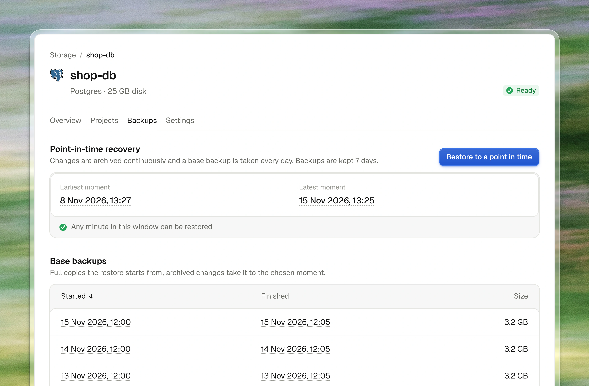

A Postgres store is one Postgres 18 server with one database, `app`, owned by the user `app`. Create it on the **Storage** page and connect it to your project as described in [Storage](/storage/overview). Your Ktor servers then get its connection details as env vars.

## Sizes

You pick the disk. CPU and memory follow from it and aren't billed.

| Disk | CPU | Memory |
|------|-----|--------|
| 1 GB or 5 GB | 0.25 vCPU | 512 MB |
| 10 GB or 25 GB | 0.5 vCPU | 1 GB |
| 50 GB or 100 GB | 1 vCPU | 2 GB |

On the free plan, a Postgres store has 1 GB disk.

## Env vars

A connected project gets these runtime env vars, with the connection's prefix in front if it has one:

| Name | Value |
|------|-------|
| `DATABASE_URL` | `postgresql://app:<password>@st-<id>.atoll-storage.svc:5432/app?sslmode=require` |
| `JDBC_DATABASE_URL` | `jdbc:postgresql://st-<id>.atoll-storage.svc:5432/app?sslmode=require` |
| `PGHOST` | `st-<id>.atoll-storage.svc` |
| `PGPORT` | `5432` |
| `PGDATABASE` | `app` |
| `PGUSER` | `app` |
| `PGPASSWORD` | 32 random letters and digits |

`JDBC_DATABASE_URL` has no user or password in it. Pass `PGUSER` and `PGPASSWORD` to your driver or pool. Both URLs ask for an encrypted connection (`sslmode=require`). The host stays the same for the store's whole life, also after a restore.

<Note>
  Only the apps of connected projects can reach the store. You can't connect to it from your own machine, and the panel has no SQL console. For local development, run Postgres on your machine and fall back to it when the env vars are missing.
</Note>

## Connect from Ktor

This example uses the Postgres JDBC driver (`org.postgresql:postgresql`) and HikariCP (`com.zaxxer:HikariCP`) in your server module:

```kotlin
import com.zaxxer.hikari.HikariConfig
import com.zaxxer.hikari.HikariDataSource

fun dataSource(): HikariDataSource = HikariDataSource(
    HikariConfig().apply {
        // Set for a connected Postgres store; local defaults otherwise.
        jdbcUrl = System.getenv("JDBC_DATABASE_URL") ?: "jdbc:postgresql://localhost:5432/app"
        username = System.getenv("PGUSER") ?: "app"
        password = System.getenv("PGPASSWORD") ?: "app"
    },
)
```

With [Exposed](https://github.com/JetBrains/Exposed), hand the pool to `Database.connect(dataSource())`. Clients that take a `postgresql://` URL with the user and password in it can use `DATABASE_URL` instead.

If you connected the store with a prefix, read the prefixed names, for example `ANALYTICS_JDBC_DATABASE_URL`.

## Backups

The platform backs up every Postgres store on its own:

- Changes are archived continuously. New changes reach the backups within about 5 minutes.
- A base backup is taken every day. The first one is taken shortly after the store is ready.
- Backups are kept 7 days.

The store's **Backups** tab shows the restore window under **Point-in-time recovery** (**Earliest moment** and **Latest moment**) and lists the base backups with when they started and finished and their size.



Backups count towards the store's billed storage. Deleting the store deletes its backups.

## Restore to a point in time

A restore takes the store back to how it was at a moment you pick, any minute within the window.

<Steps>
  <Step title="Open the backups">
    Open the store's **Backups** tab and click **Restore to a point in time**.
  </Step>
  <Step title="Pick the moment">
    Pick the **Day** and enter the **Time** as `HH:MM`, in your local time. Click **Continue**.
  </Step>
  <Step title="Confirm">
    Check the moment and click **Restore**.
  </Step>
</Steps>

The store shows **Restoring**. The platform first waits about 6 minutes for the latest changes to reach the backups, then restores a copy of the database to the chosen moment. Your apps keep using the current data until the restored database takes over. After that, the store serves the restored data under the same host and password, so your apps keep their connection settings.

<Warning>
  Everything written after the chosen moment is lost, including what your apps write while the restore runs.
</Warning>

- Restoring needs the Admin role, and the store must be **Ready**.
- While a store restores, it can't be resized.
- If a restore fails, or doesn't finish within 12 hours, the store keeps its data from before the restore. The **Overview** tab says what went wrong.

<Note>
  On a self-hosted server without backup storage, the **Backups** tab says that backups are off. See [Storage](/self-hosting/storage).
</Note>

## Resize

Open the store's **Settings** tab and click **Resize**. See [Resize a store](/storage/overview#resize-a-store) for the steps.

- The disk grows while the database keeps running.
- When the new size also moves the store up a CPU and memory step (past 5 GB or past 25 GB), Postgres restarts once. Open connections drop briefly and your apps have to reconnect.
- The store can't shrink again.
