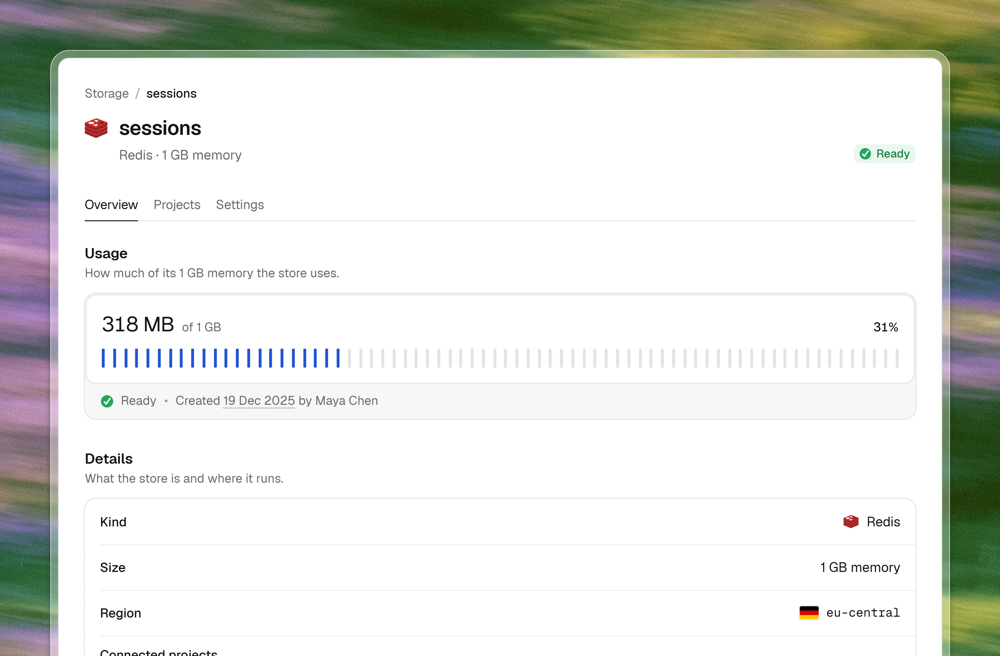

A Redis store is one Valkey 9 server. Valkey speaks the Redis protocol, so Redis clients work with it. Create the store on the **Storage** page and connect it to your project as described in [Storage](/storage/overview). Your Ktor servers then get its connection details as env vars.



## Sizes

You pick the memory. The store also gets a disk twice that size for its data file, and 0.25 vCPU. Only the disk is billed.

| Memory | Data limit | Disk |
|--------|------------|------|
| 256 MB | 192 MB | 512 MB |
| 1 GB | 896 MB | 2 GB |
| 4 GB | 3.5 GB | 8 GB |

The data limit is a little below the memory: Valkey keeps an eighth of it, at least 64 MB, free for buffers and for rewriting its data file. On the free plan, a Redis store has 256 MB memory.

## When the store is full

The store doesn't evict keys to make room. Once the data reaches the limit, commands that add data fail with an out-of-memory error. Reads and deletes keep working.

- Give cache entries an expiry, for example with `SETEX` or `EXPIRE`.
- [Resize](#resize) the store if it needs more room.

## Persistence

Valkey writes every change to an append-only file on disk and flushes it once a second. When the store restarts, for a resize or new credentials, it loads its data from that file. If it crashes, the last second of writes can be lost.

There are no backups of Redis stores and no restore. Keep data you can't rebuild in [Postgres](/storage/postgres).

## Env vars

A connected project gets these runtime env vars, with the connection's prefix in front if it has one:

| Name | Value |
|------|-------|
| `REDIS_URL` | `redis://default:<password>@st-<id>.atoll-storage.svc.cluster.local:6379` |
| `REDIS_HOST` | `st-<id>.atoll-storage.svc.cluster.local` |
| `REDIS_PORT` | `6379` |
| `REDIS_PASSWORD` | 32 random letters and digits |

The connection is a plain `redis://` connection without TLS, as the user `default`.

<Note>
  Only the apps of connected projects can reach the store. You can't connect to it from your own machine. For local development, run Redis or Valkey on your machine and fall back to it when the env vars are missing.
</Note>

## Connect from Ktor

This example uses [Lettuce](https://lettuce.io) (`io.lettuce:lettuce-core`) in your server module:

```kotlin
import io.ktor.server.application.Application
import io.ktor.server.application.ApplicationStopped
import io.lettuce.core.RedisClient

fun Application.redis() {
    // Set for a connected Redis store; a local server otherwise.
    val client = RedisClient.create(System.getenv("REDIS_URL") ?: "redis://localhost:6379")
    val connection = client.connect()
    val commands = connection.sync()

    commands.setex("greeting", 3600, "Hello, world!")
    log.info("Cached: {}", commands.get("greeting"))

    monitor.subscribe(ApplicationStopped) {
        connection.close()
        client.shutdown()
    }
}
```

If you connected the store with a prefix, read the prefixed name, for example `CACHE_REDIS_URL`.

## Resize

Open the store's **Settings** tab and click **Resize**. See [Resize a store](/storage/overview#resize-a-store) for the steps.

- Valkey restarts once with the new memory and disk, then loads its data from disk.
- Connections drop briefly while it restarts. Your apps have to reconnect.
- The store can't shrink again.

## What is turned off

Modules and the `DEBUG` command are turned off, and protected settings can't be changed with `CONFIG SET`.
