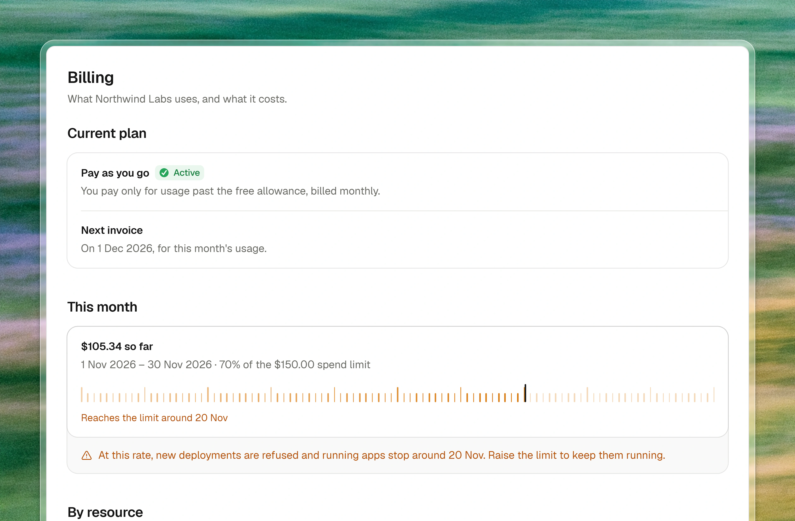

## What is metered

| Resource | Free each month | Then |
|----------|-----------------|------|
| Build time | 300 build minutes | $0.01 per build minute |
| CPU | 100 vCPU-hours | $0.04 per vCPU-hour |
| Memory | 200 GB-hours | $0.005 per GB-hour |
| Bandwidth | 100 GB | $0.08 per GB |
| Storage | 5 GB-months | $0.10 per GB-month |
| Windows build time | 0 Windows build minutes | $0.02 per Windows build minute |
| macOS build time | 0 macOS build minutes | $0.10 per macOS build minute |

- **Build time**: the minutes your builds run.
- **CPU and memory**: the size of your running Ktor servers (set on the Scaling tab) times the replicas that run,
  counted every minute; nothing while a server is scaled to zero. Half a vCPU for a 730-hour month is 365
  vCPU-hours; 1 GB of memory for the same month is 730 GB-hours.
- **Bandwidth**: the data your web apps and Ktor servers send out.
- **Storage**: the sources, web apps and files the platform keeps for your deployments, and your [data stores](/storage/overview): each store's provisioned disk, plus Postgres backups and the objects in Files stores.
- **Windows and macOS build time**: the minutes one of the shared Windows or macOS build runners spends on your
  deployment, e.g. on a `.msi` installer. There is no free amount: on the free plan the shared runners don't build for
  you, so these targets are skipped with a note unless your org has its own runner for that system. Your own
  [build runners](/run/runners) are free.

Previews use the same meters as production.

## Plans

| Plan | How it works |
|------|--------------|
| Free | The free amounts are hard limits. No card needed. |
| Pay as you go | Usage past the free amounts is charged to your card. Stripe sends one invoice per month. |

Every org starts on the free plan. To switch, an admin opens the org's **Billing** tab and adds a payment method. Payments are handled by Stripe.

## What happens at a limit

On the free plan:

- When the org uses up **any** free amount, new deployments are refused.
- When it uses up its free **CPU, memory or bandwidth**, its running apps are also stopped: Ktor servers are scaled to zero, and web apps show a "paused" page (HTTP 402).

On pay as you go, the same happens to both once the org reaches its [spend limit](#spend-limits).

A refused deployment gets a message that says why and links to the org's **Billing** tab, for example:

```text
Server error 402: Org 'acme' has used up its free 300 build minutes for this month. Add a payment method to switch to pay-as-you-go: https://atoll.example.com/#/orgs/acme/billing
```

The CLI exits with code `1`. Git pushes that are refused show as a failed commit status on GitHub.

Everything starts again on its own, within about a minute, when the next month starts, a card is added or the limit is raised. Stopped apps come back with the number of replicas they had.

If a payment fails, the org has 7 days to pay or update its payment method. After that, new deployments are refused until it does. Running apps are not stopped for a failed payment.

## Spend limits

An admin can set a monthly spend limit in the **Billing** tab. Once the month's cost reaches it, new deployments are refused and running apps are stopped, as above. Raise or remove the limit to start them again.

## Usage and invoices

The **Billing** tab shows, for the current month:

- each resource, how much you used, how much of it was free, and what it costs;
- the total so far.



Past invoices are listed with their status (open, paid and so on) and a link to the invoice. Admins can update the card and billing details in the Stripe customer portal, linked from the same tab.

Viewing usage needs the Viewer role. Everything else in billing needs the Admin role.

## Self-hosted servers

A self-hosted server meters usage the same way, but billing is only on when it has a Stripe key. Without one, nothing is refused or stopped. Operators set the prices and free amounts; see [Billing settings](/self-hosting/billing-settings).
