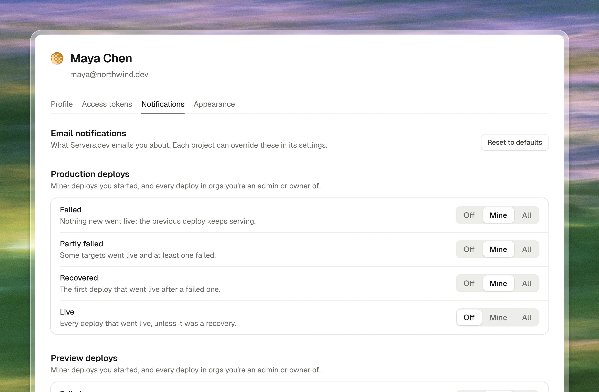

## What you get by default

| Event | Default |
|-------|---------|
| Production deploy failed, partly failed, recovered | Mine |
| Production deploy live | Off |
| Preview deploy failed, partly failed, recovered, live | Off |
| Spend limit at 80%, spend limit reached | Mine |
| Runner offline or back online | Mine |

Each event is **Off**, **Mine** or **All**:

- **Mine**, for deploys: the deploys you started, and every deploy of projects in orgs where you're an admin or owner. For billing and runners: the orgs where you're an admin or owner.
- **All**: every project and org you're a member of.

"Recovered" is the first deploy that goes live after a failed or partial one; you get it instead of the "live" email.

Only verified email addresses get notifications. You only ever get emails about orgs you're a member of.

## Change them

- **Your defaults**: in the **Notifications** tab of the **Account** page. **Reset to defaults** brings back the table above.
- **One project**: in the project's **Settings** tab. Turn off **Use my defaults** and pick per event. Only you see these.

## Unsubscribe

Every email ends with an unsubscribe link. It turns that event off for that project (or, for billing and runner emails, in your defaults), so other projects keep notifying you. Mail apps that show an unsubscribe button use the same link.

## Bursts

If several things happen at once, say ten previews failing within a minute, you get the first email right away and the rest together in one digest a minute later.

## Self-hosting

Notifications need accounts (a database) and use the same SMTP settings as sign-up emails. Without SMTP they are written to the server log. See [Settings](/self-hosting/settings#email-notifications).
