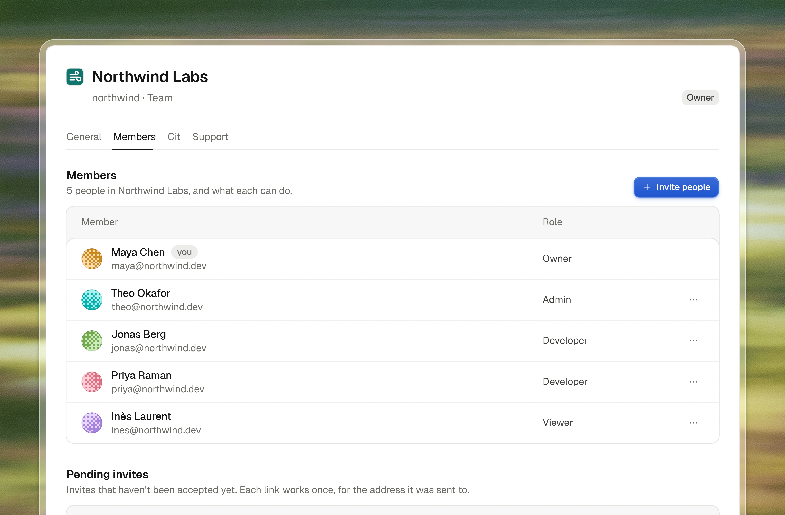

## Orgs

- Every user has a personal org. Projects you create without naming an org go there. A personal org can't be deleted, and its owner can't be removed or demoted.
- Create more orgs for teams or companies. Each org has its own projects, members, billing and GitHub installations.
- An org has a slug, used in URLs: 3 to 40 lowercase letters, digits or `-`, starting with a letter, without `--` and not ending with `-`.

`atoll whoami` and `atoll orgs ls` list your orgs and your role in each. `atoll orgs switch <slug>` picks the org that `atoll deploy` and `atoll projects` use for new projects.

## Roles

Each member has one role per org. Each role can do everything the role above it can, plus more:

| Action | Minimum role |
|--------|--------------|
| Read projects, deployments, logs, non-secret env values, domains, usage | Viewer |
| Deploy, cancel, promote, edit env vars | Developer |
| Domains, git link, project deletion, members and invites, billing | Admin |
| Delete or rename the org, change owners | Owner |

An org always keeps at least one owner.

If you cannot read a project, the platform answers as if it does not exist (404). If you can read it but your role is too low for a change, you get a "forbidden" error (403).

## Invite people

Admins invite from the org's **Members** tab:

1. Enter an email address and pick a role. Developer is the default.
2. The platform emails an invite link. It expires after 7 days; send a new one if it does.
3. The person signs in or signs up with that email, verifies it, and accepts.

An invite can only be accepted by a signed-in user whose verified email matches the invited address. Admins can cancel open invites. Only owners can invite someone as an owner.

## Change roles and remove members

Admins change roles and remove members in the **Members** tab. Only owners can make someone an owner, change an owner's role or remove an owner.

## Signing in and tokens

Signing in, verifying your email and when the panel asks you to sign in again are on [Your account](/account/account). Personal access tokens for CI and scripts, and approving `atoll login` in the browser, are on [Access tokens](/account/tokens).

A token acts as you, with your roles in every org.

## Delete an org

Only owners can delete an org, and only once it has no projects. Delete its projects first; that needs the Admin role.
